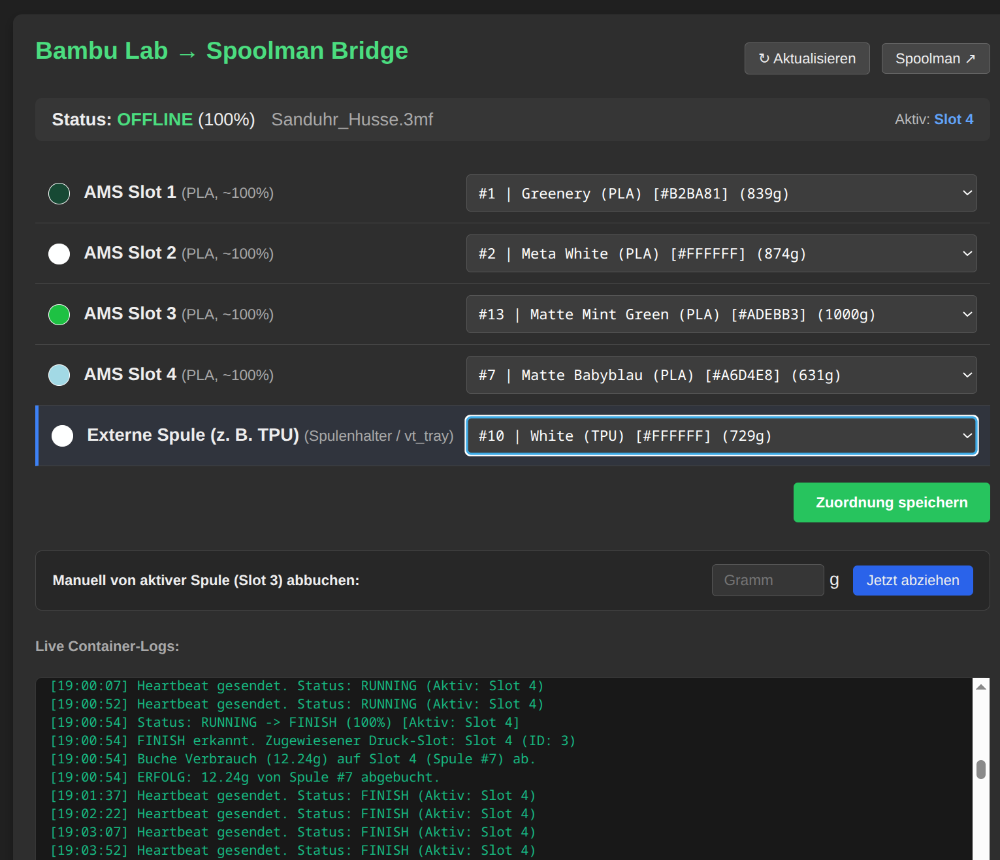
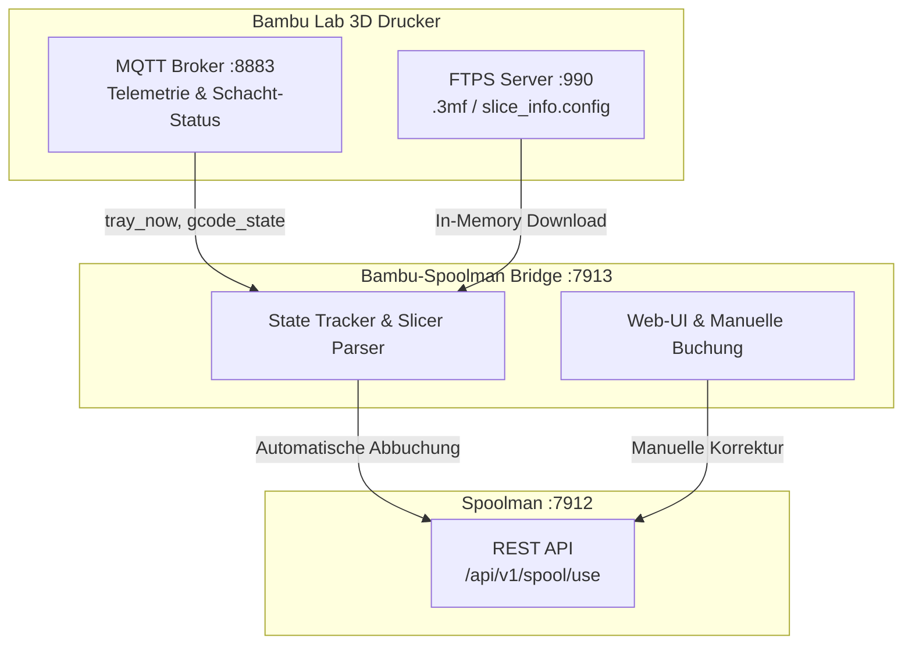

# Bambu Lab to Spoolman Bridge

Eine leichtgewichtige, containerisierte Schnittstelle zur automatischen Erfassung des Filamentverbrauchs von **Bambu Lab 3D-Druckern** (A1-Serie, P1-Serie, X1-Serie) in **Spoolman**.



---

## Highlights & Gelöste Herausforderungen

1. **Grammgenaue Slicer-Verbräuche via Implizites FTPS (Port 990)**:
   - Lädt beim Druckstart die Modelldatei (\`.3mf\` bzw. \`.gcode.3mf\`) rein im Arbeitsspeicher (\`io.BytesIO\`) herunter.
   - **Kein Datenmüll**: Die Modelldatei wird zu keinem Zeitpunkt auf der Festplatte zwischengespeichert und nach dem Extrahieren der \`slice_info.config\` sofort verworfen.

2. **Schacht-Zuverlässigkeit & Unload-Schutz (State-Locking)**:
   - Verhindert Fehlbuchungen durch den automatischen Filamentrückzug (*Unload* / Code \`255\`) bei Druckende (100 %).
   - Die Bridge lockt den während des Druckens aktiven Schacht und bucht auch nach dem Entladen punktgenau ab.

3. **Robuste Delta-Update-Auswertung via MQTT (Port 8883)**:
   - Liest verschachtelte Status-Bits (\`ams.tray_now\`, \`ams.tray_tar\`) mit automatischer 0-Index-Korrektur aus.

4. **Ressourcenschonend & Wartungsfrei**:
   - **Kein Speicherüberlauf**: Web-Logs werden in einem Python-Ringpuffer (\`deque(maxlen=250)\`) gehalten. Älteste Einträge verfallen automatisch.
   - Integrierte Docker-Log-Rotation (\`max-size: 10m\`, \`max-file: 3\`).
   - Vollständig lokaler Betrieb ohne Cloud-Zwang.

---

## Architektur



---

## Schnellstart

### 1. Repository klonen & Konfiguration anlegen
```bash
git clone [https://github.com/andreas-fe/bambu-spoolman.git](https://github.com/andreas-fe/bambu-spoolman.git)
cd bambu-spoolman
cp .env.example .env
```

Passe die Werte in `.env` an:
```env
BAMBU_HOST=192.168.1.50
BAMBU_ACCESS_CODE=12345678
BAMBU_SERIAL=0123456789ABCDE
SPOOLMAN_URL=http://spoolman:8000
```

### 2. Starten
```bash
docker compose up -d --build
```

- **Webinterface (Bridge)**: `http://<HOST-IP>:7913`
- **Spoolman**: `http://<HOST-IP>:7912`

---

## Lizenz
MIT License
