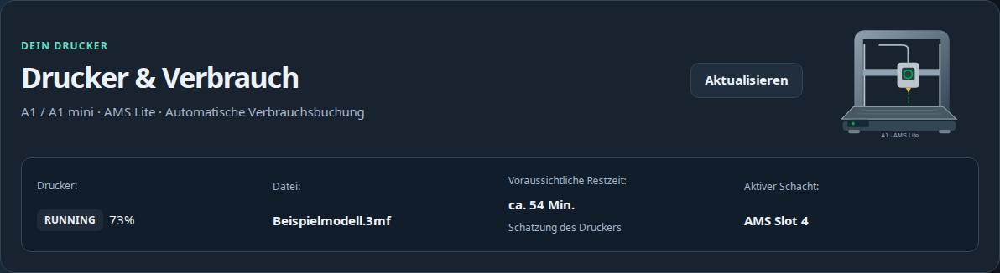
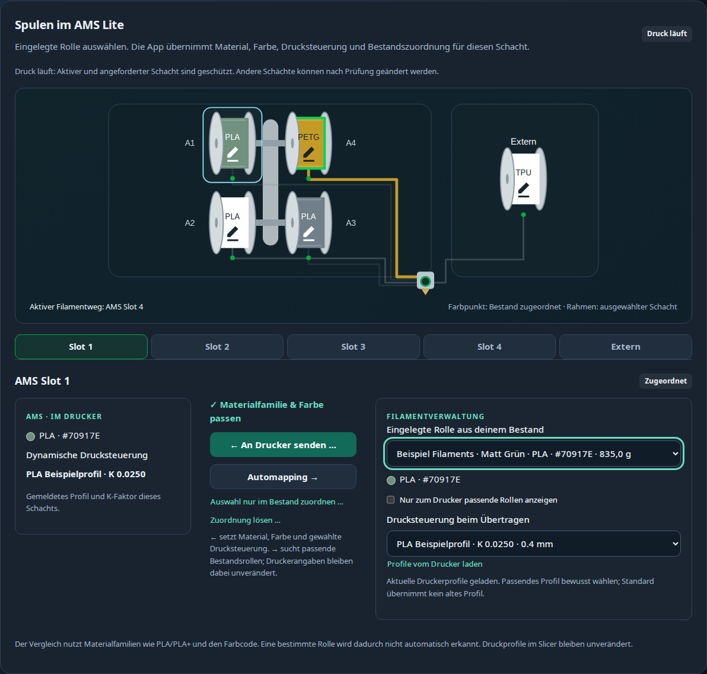
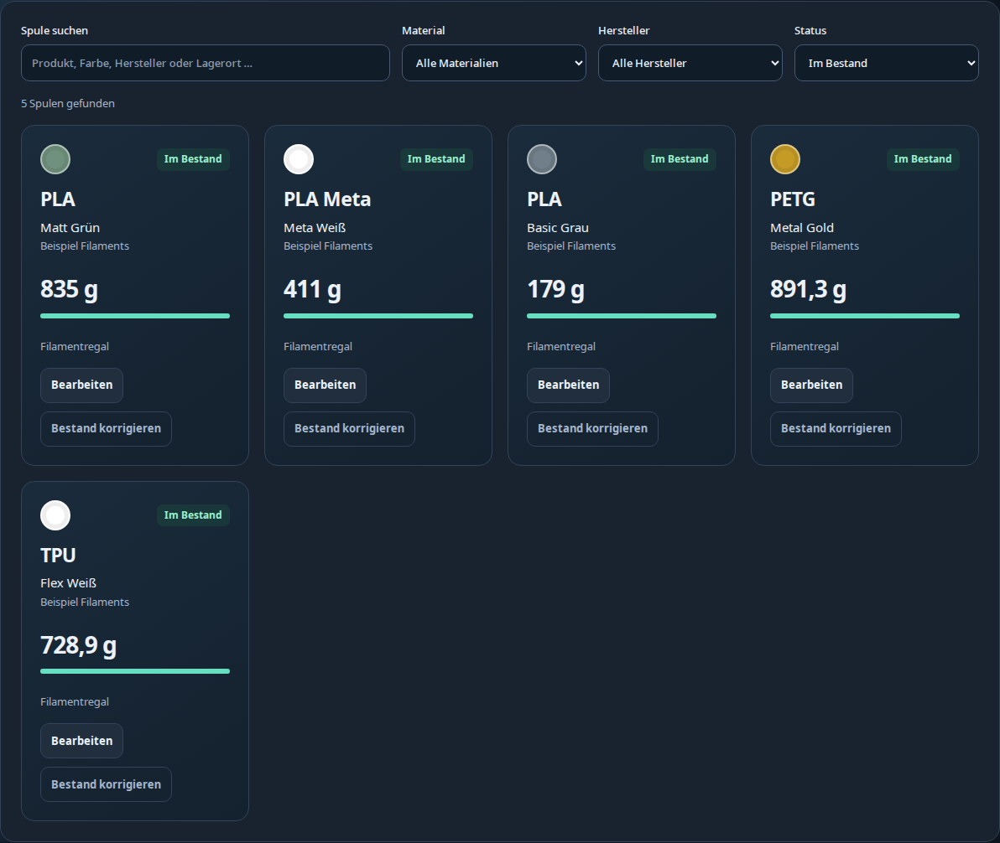
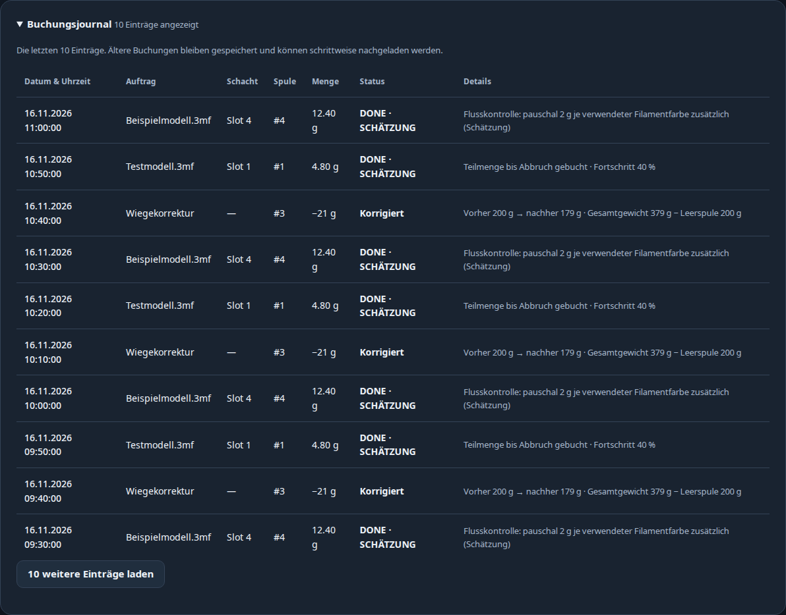
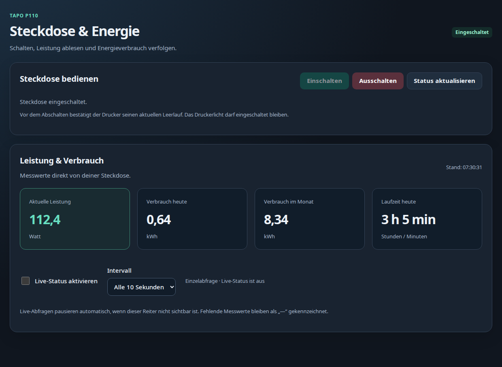

# Bambu-Spoolman-Plus

Lokale Docker-Anwendung für Bambu Lab A1/A1 mini und AMS Lite: Filamentbestand verwalten, eingelegte Rollen samt Material und Farbe dem Drucker zuweisen, Verbrauch nach dem Druck buchen und Kamera, Licht sowie Tapo-Steckdose bedienen.



**Stand: 16. November 2026.** Alle aktuellen Screenshots wurden aus dieser Oberfläche mit künstlichen Beispieldaten erstellt. Sie enthalten keine echten Bestände oder Zugangsdaten. Die Funktionen und ihre Grenzen beschreibt die [ausführliche Bedienungsanleitung](docs/user-guide.md).

## Funktionen

- **Darstellung:** Helles oder dunkles Design für alle Bereiche, mit gespeicherter Auswahl pro Browser.
- **Druckübersicht:** Zustand, Fortschritt, Datei, aktiver AMS-Schacht und vom Drucker gemeldete Restzeit; schematische A1-Darstellung.
- **Grafisches AMS Lite:** Rolle auswählen, Material, Farbe und dynamische Drucksteuerung prüfen und bestätigen; gerichteter Abgleich zwischen Drucker und Bestand, Bestandsbindung erst nach vollständiger Druckerrückmeldung. Änderungen an eindeutig inaktiven Schächten sind auch während eines Drucks möglich; aktive und angeforderte Schächte bleiben geschützt.
- **Integriertes Inventar:** Hersteller, Produkte, physische Rollen und Lagerorte; Suchfilter, sortierbare Tabellen, getrennte Leergewichte und freie Zusatzangaben. Hersteller direkt im Produktdialog anlegen.
- **Wiegekorrektur:** Gesamtgewicht eingeben; die App zieht das bekannte Leerspulengewicht ab und setzt den Restbestand. Auch unbekannte Bestände können so erfasst werden.
- **Katalogvorlagen:** Optionale SpoolmanDB-Suche für neue Produkte. Vorlagen prüfen und übernehmen; keine automatische Änderung bestehender Produkte oder Slicer-Profile.
- **Verbrauch und Journal:** Slicer-Grammwerte der gedruckten Platte, eingefrorene Bestands-/Zuordnungssnapshots, Abbruchschätzungen, manuelle Korrekturen und nachvollziehbare Wiegedaten mit Datum und Uhrzeit. Einklappbares Journal mit zehn Einträgen und schrittweisem Nachladen.
- **Flusskontrolle:** Optional 2 g Zusatzverbrauch pro positiver Slicer-Filamentposition, einmalig je Auftrag und als Schätzung gekennzeichnet. Die Option startet keine Kalibrierung. Frisch gemeldete Kalibrierungsphasen werden pro Auftrag gespeichert; der Zuschlag ist wahlweise pauschal oder nur bei positivem Nachweis möglich.
- **Druckerspeicher:** Eigener Reiter mit Listen-/Kachelansicht, Alters-/Größenfiltern, Modellminiaturen, Dateidetails mit Druckplatten und Historie, geprüftem 3MF-Druckstart und bestätigter Mehrfachlöschung samt Platzberechnung. Laufende/offene Druckaufträge bleiben geschützt; keine automatische Bereinigung.
- **Kamera und Licht:** Livebild bei Bedarf, Lichtschalter oberhalb der Bildfläche und neue Gerätezustandsbestätigung vor Erfolgsmeldung.
- **Tapo P110:** Ein-/Ausschalten, Live-Leistung, Tages-/Monatsenergie und Laufzeit. Ausschalten verlangt bestätigten frischen Druckerleerlauf; eingeschaltetes Licht blockiert nicht.
- **Auftragsbezogene Abschaltung:** Optional nach erfolgreichem Ende, abgeschlossener Buchung und 1–3 Minuten Wartezeit; standardmäßig aus. Keine temperaturgeführte Abkühlprüfung.
- **Zwei Bestandssysteme:** Bestehendes Spoolman oder nach kontrollierter Migration internes SQLite-Inventar. Genau ein schreibendes Bestandssystem; kein stiller Backendwechsel.

## Voraussetzungen

Für die **Übertragung von Material und Farbe an das AMS müssen am Drucker LAN-only und Entwicklermodus aktiviert sein**. Der Moduswechsel erfolgt am Drucker nach Druckende. Ohne diese Freigabe kann die getestete Firmware Schreibbefehle ablehnen, obwohl Status und Bambu Studio funktionieren. LAN-only verändert die bisherige Bambu-Cloud-/Handy-Nutzung. Die App ändert den Modus nicht selbst. [Druckermodus einrichten](docs/user-guide.md#voraussetzungen-und-druckermodus).

Weitere Voraussetzungen:

- Docker Compose v2 und persistentes Datenverzeichnis.
- Lokale Drucker-Erreichbarkeit: MQTT/TLS 8883, FTPS 990 und passive Datenports; für Livebild unterstützter LAN-Kamerastream.
- Aktueller LAN-Zugangscode und Druckerkennung ausschließlich in privater Konfiguration.
- Bei Spoolman-Betrieb eine erreichbare vorhandene Instanz und das in Compose angegebene externe Docker-Netzwerk. Bei internem Bestand bleibt dieses Netzwerk eine Compose-Voraussetzung, solange die mitgelieferte Datei unverändert verwendet wird; ein laufender Spoolman-Dienst ist dafür nicht erforderlich.
- Optional Tapo P110 und private Gerätezugänge für Schalten und Energiemessung.

## Oberfläche nach Bereichen

### AMS Lite



[Normaler Rollenwechsel, Fallback und Schutz während des Drucks](docs/user-guide.md#spulen-im-ams-lite).

### Filamentbestand



[Produkte und Rollen](docs/user-guide.md#filamente-und-physische-spulen) · [Wiegekorrektur](docs/user-guide.md#wiegen-und-bestandskorrektur) · [Archivierte Rollen entfernen](docs/user-guide.md#löschen-und-archivieren).

### Buchungsjournal



[Aufträge und Buchungszustände verstehen](docs/user-guide.md#journal-und-offene-druckaufträge).

### Steckdose und Energie



[Manuell schalten und Live-Abfragen](docs/user-guide.md#steckdose-und-energie) · [Nach einem Druck ausschalten](docs/user-guide.md#automatisch-nach-dem-druck-ausschalten).

Screenshots für **Kamera, Produktverwaltung, Wiegen, Abschaltautomatik und Einstellungen** stehen in der [Bedienungsanleitung](docs/user-guide.md). Herkunft und Grenzen der Abbildungen: [Screenshot-Hinweise](docs/assets/current/README.md).

## Einrichtung und Aktualisierung

```sh
cp .env.example .env
# Private lokale Werte in .env eintragen.
mkdir -p data
# Das konfigurierte externe Netzwerk muss bereits vorhanden sein.
docker compose up -d --build
```

Die Weboberfläche ist unter `http://<Docker-Host>:7913` erreichbar. Beide Web-Zugangswerte setzen, bevor andere Geräte Zugriff erhalten. Standard: `INVENTORY_BACKEND=spoolman` und `DRY_RUN=true`. Im Spoolman-Modus ist die native Inventaransicht eine Vorschau; deren Bearbeitung wird erst nach kontrollierter Aktivierung des internen Backends freigeschaltet.

**Bestehende Installationen nicht mit einer leeren Datenbank neu aufsetzen.** Vor Aktualisierung oder Migration vollständige private Sicherungen erstellen, Kandidat mit einer Datenkopie prüfen und erst dann freigeben. Nach Start Health, Betriebsmodus, Journal, Bestände und Geräteansichten prüfen. Anleitung: [Betrieb, Migration, Backup und Rollback](docs/plus-operations.md).

Das historische `deploy_qnap.py` darf für diesen Plus-Stand **nicht unverändert** eingesetzt werden: Es bildet die neuen Python-Module und den vom laufenden Spoolman unabhängigen Betrieb nicht vollständig ab. Neue Images aus dem gesamten Verzeichnis `bridge/` bauen. Individuelle Infrastruktur und Deployment-Protokolle gehören nicht ins öffentliche Repository. [Prüf- und Freigabestand](DEPLOYMENT.md).

## Verarbeitung und Architektur

[Kommunikationsflow](docs/flows/communication.md) · [Verarbeitungsflow](docs/flows/processing.md) · [Ausführliche Architektur](docs/architecture.md) · [Filament-Workflow](docs/filament-workflow.md).

Die Slicer-Filamentposition ist kein physischer AMS-Schacht. Die Bridge verwendet ausdrückliche Auftragszuordnungen, Drucker-Mapping und als Fallback den exakten Farb-/Materialfamilienabgleich. Slot→Bestandsrolle und Auftragszuordnung werden getrennt behandelt. Während des Druckens wird kein Verbrauch abgebucht.

Nach FINISH werden die Grammwerte der ausgewählten Platte gebucht. Bei Abbruch wird nach Fortschritt geschätzt. Rollenaufteilungen, unbestätigte Reserven und Flusszuschlag bleiben als Schätzung kenntlich. Die interne Buchung aktualisiert Bestand, Verbrauch und Journal atomar und idempotent. Der externe Spoolman-Weg schützt unklare Ergebnisse vor automatischer Wiederholung.

## Validierung und bekannte Grenzen

Stand 16. November 2026: **211 Tests lokal und im NAS-Container bestanden**. Die Tests verwenden temporäre Daten und simulierte Geräte. Browserprüfungen decken Rollenwahl, Vorschau, Einzelschachtaktionen, aktive Schachtsperre und mobile Darstellung ab.

Am Referenzsystem wurden Licht, manuelles Schalten und ein tatsächlicher AMS-Farbwechsel im Leerlauf geprüft; ursprüngliche Farbe und Bestandsbindung wurden danach wiederhergestellt. Ein echter Farbwechsel während eines laufenden Drucks nach Modusumstellung sowie ein vollständiger automatischer Abschaltzyklus der neuen Funktion sind noch nicht hardwarebestätigt. Das ist kein Freigabenachweis für andere Modelle oder Firmwarestände.

## Dokumentation

- [Bedienungsanleitung mit Screenshots](docs/user-guide.md)
- [Betrieb, Migration, Sicherung und Wiederherstellung](docs/plus-operations.md)
- [Architektur und Datenquellen](docs/architecture.md)
- [Filament- und Auftragszuordnung](docs/filament-workflow.md)
- [Changelog](CHANGELOG.md)
- [Prüfstand](DEPLOYMENT.md)

Private `.env`, SSH-Schlüssel, Passwörter, Druckerzugänge, Datenbanken, Logs und Inventarexporte niemals veröffentlichen. Die Anwendung gehört in ein vertrauenswürdiges lokales Netz; keine ungeschützte Internetfreigabe einrichten.
