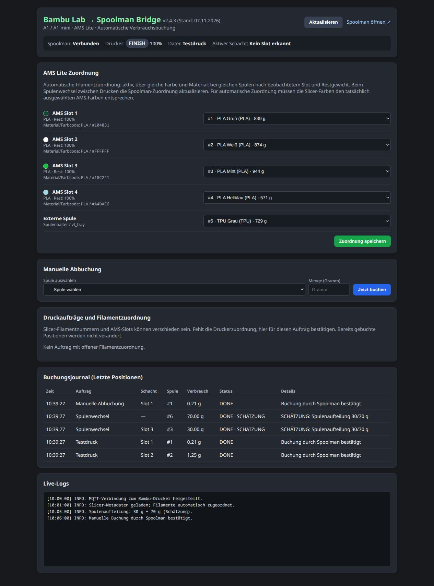
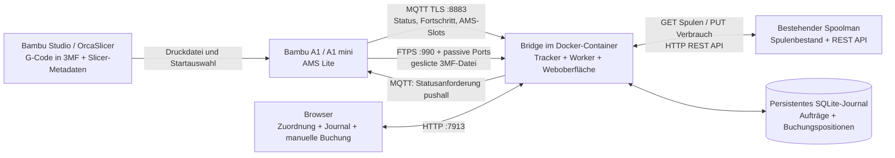
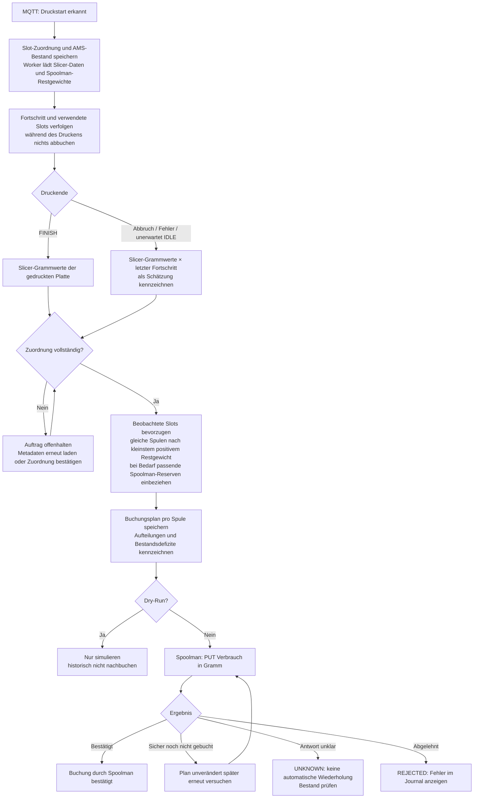

# Bambu → Spoolman Bridge

Lokale Docker-Bridge für Bambu Lab A1/A1 mini mit AMS Lite und eine **bereits laufende Spoolman-Instanz**. Nach `FINISH` werden die Slicer-Verbrauchswerte aus der gedruckten 3MF-Datei pro Filament der zugeordneten Spoolman-Spule belastet. Bei Abbruch wird eine ausdrücklich gekennzeichnete Schätzung automatisch verbucht.

## Funktionen im Überblick

- **Lokale Druckerkommunikation:** MQTT über TLS liefert Status, Fortschritt und AMS-Daten; FTPS lädt die geslicte 3MF-Datei in den Arbeitsspeicher.
- **Slicer-basierte Verbräuche:** Grammwerte, Farben und Materialtypen aus `Metadata/slice_info.config`, passend zur gedruckten Platte. Die Bridge berechnet keine exakten Messwerte aus einzelnen G-Code-Bewegungen.
- **Mehrmaterial und AMS Lite:** Drucker-/Benutzerzuordnung oder automatischer Farb- und Materialvergleich; Slot→Spoolman-Spule wird zum Druckstart gespeichert.
- **Spulenwechsel und Reserven:** Gewichtsbasierte Aufteilung auf passende Spulen, beispielsweise 30 g + 70 g; unbestätigte physische Spulenwechsel werden als Schätzung gekennzeichnet.
- **Abbruchbehandlung:** Automatische, gekennzeichnete Schätzung anhand des zuletzt bekannten Fortschritts.
- **Weboberfläche:** Slot-Zuordnung, manuelle Abbuchung, auftragsbezogene Bestätigung, Live-Status, Logs und Buchungsjournal.
- **Dauerhafter Betrieb:** SQLite-Journal, eingefrorene Buchungspläne, sichere Wiederaufnahme, Dry-Run, persistente Formularsitzungen und optionale Web-Anmeldung.
- **Docker auf QNAP:** Eigenständige Bridge für einen bestehenden Spoolman, Healthcheck, Log-Rotation, SSH-Deployment mit Backup und Rückfallmöglichkeit.

## Aktuelle Oberfläche



*Screenshot der GUI v2.4.3 mit anonymisierten Beispieldaten. Die dargestellten Buchungen und Logs sind Demonstrationsdaten.*

## Kommunikation und Verarbeitung

Jeder Flow steht in einem eigenen Diagrammfeld und lässt sich unabhängig öffnen und zoomen.

### Kommunikationsflow

Verbindungen zwischen Drucker, Bridge, Spoolman, Datenbank und Browser.

[Einzelansicht öffnen und separat zoomen](docs/flows/communication.md)



---

### Verarbeitungsflow

Verarbeitung vom Druckstart bis zur bestätigten Buchung oder Fehlerbehandlung.

[Einzelansicht öffnen und separat zoomen](docs/flows/processing.md)



Das [detaillierte Kommunikations- und Verarbeitungskonzept](docs/architecture.md) erklärt Protokolle, Datenquellen, Zustände, Spulenaufteilung und die Grenzen der Schätzungen. Änderungen stehen im [Changelog](CHANGELOG.md), der freigegebene Betriebsstand in [DEPLOYMENT.md](DEPLOYMENT.md).

## Einrichtung

Voraussetzungen: Docker Compose v2, erreichbarer Drucker mit LAN-Zugangscode (MQTT TLS 8883, implizites FTPS 990 sowie passive Datenports), vorhandene Spulen in Spoolman. Die Compose-Datei benötigt den Namen eines bereits bestehenden Docker-Netzwerks, an dem Spoolman angeschlossen ist (`SPOOLMAN_NETWORK`). Diesen Namen zeigt `docker inspect spoolman --format '{{json .NetworkSettings.Networks}}'`.

```sh
cp .env.example .env
# .env mit lokalen Werten bearbeiten
mkdir -p data
docker compose up -d --build
```

Weboberfläche: `http://<NAS-IP>:7913`. Dort die vier AMS-Slots und optional die externe Spule zuweisen. Der Dienst startet standardmäßig mit `DRY_RUN=true`: Das Journal zeigt simulierte Verbräuche; Spoolman bleibt unverändert. Nach einem erfolgreich geprüften Druck `DRY_RUN=false` setzen und den Container neu erstellen:

```sh
docker compose up -d --force-recreate bambu-bridge
```

Historische Simulationen werden **nicht** nachgebucht. Manuelle Buchungen unterliegen ebenfalls dem Dry-Run-Modus.

## Spoolman-Verbindung

`SPOOLMAN_URL` muss aus dem Bridge-Container erreichbar sein, beispielsweise `http://<NAS-IP>:7912`. Der Name `http://spoolman:8000` funktioniert nur, wenn beide Container ein gemeinsames Docker-Netzwerk mit diesem DNS-Namen verwenden. Diese Compose-Datei verbindet die Bridge zusätzlich mit `SPOOLMAN_NETWORK`, betreibt ausschließlich die Bridge und verändert den vorhandenen Spoolman nicht. Auf QNAP kann die Verbindung zur eigenen NAS-IP aus dem Container blockiert sein; dann die direkte interne Adresse im gemeinsamen Netzwerk verwenden. `SPOOLMAN_BROWSER_URL` legt unabhängig davon den erreichbaren Browser-Link fest.

Die Oberfläche zeigt den Verbindungsstatus. Die Buchung verwendet Spoolmans `PUT /api/v1/spool/{id}/use` mit `use_weight` in Gramm. API-Referenz: [Spoolman](https://github.com/Donkie/Spoolman/blob/master/spoolman/api/v1/spool.py).

## AMS- und Druckdaten

Für den täglichen Einsatz: [Schritt-für-Schritt-Anleitung für AMS, Slicer-Projekt und Spoolman](docs/filament-workflow.md). Dort sind auch [die Grenzen der AMS-Slot-Erkennung aus 3MF-Dateien](docs/filament-workflow.md#kann-die-3mf-den-verwendeten-ams-slot-verraten) und [die Regeln für Slicer-Farbcodes](docs/filament-workflow.md#welche-farbcodes-darf-ich-im-slicer-verwenden) erklärt. Sie erklärt auch, warum eine Profil-Standardfarbe allein nicht genügt und warum Spoolman seine reale Filamentfarbe behalten darf.

Slicer-Filament-IDs und `T0`/`T1` im G-Code sind keine verbindlichen physischen AMS-Slots: Die Auswahl beim Druckstart kann sie auf andere Slots abbilden.

Die Bridge verwendet zuerst eine ausdrücklich bestätigte Zuordnung oder `ams_mapping`/`ams_mapping2` vom Drucker. Fehlen diese Daten, ist mit `AUTO_MATCH_FILAMENTS=true` ein exakter Vergleich von **RGB-Farbe und Materialtyp** möglich: Die 3MF-Filamentdaten werden mit einem gespeicherten AMS-Bestand zum Druckstart verglichen. Es gibt keine Farbtoleranz, keine Auswahl nach Ähnlichkeit und keinen Vergleich mit möglicherweise abweichenden Spoolman-Farben. Das Journal nennt die Quelle der automatischen Zuordnung.

Diese Automatik setzt voraus, dass die Slicer-Farben den beim Druckstart tatsächlich gewählten AMS-Farben entsprechen. Bei absichtlich abweichender Farbauswahl die Zuordnung für den Auftrag ausdrücklich bestätigen oder `AUTO_MATCH_FILAMENTS=false` setzen. Die externe Spule wird nicht allein anhand einer Farbe automatisch gewählt.

Bei mehreren passenden AMS-Spulen haben die während des Druckens beobachteten Slots Vorrang; anschließend werden Spulen mit dem kleinsten positiven Restgewicht zuerst berücksichtigt. Fehlt eine notwendige Zuordnung oder fehlen bei gleichartigen Spulen alle Restgewichte, wartet der **gesamte Auftrag** mit `WAITING_MAPPING`; auch andere Positionen bleiben vorerst ungebucht. Unter „Druckaufträge und Filamentzuordnung“ kann die Zuordnung für genau diesen Auftrag bestätigt werden. Positionen ohne bisherigen API-Versuch können dabei korrigiert werden. Bereits verarbeitete Positionen sind gesperrt; die Bestätigung gilt nicht für spätere Drucke.

Beim **Spulenwechsel zwischen Drucken** immer die AMS-Slot→Spoolman-Spule-Zuordnung aktualisieren und Farbe sowie Material im Drucker korrekt pflegen. Für mehrere gleichartige Spulen wird die Menge anhand der zu Druckbeginn gespeicherten Restgewichte aufgeteilt, zum Beispiel 30 g aus der ersten und 70 g aus der zweiten Spule bei 100 g Gesamtverbrauch. Bereits für andere Slicer-Filamente reservierte Mengen werden dabei berücksichtigt. Diese Aufteilung ist eine **Schätzung**, keine Messung des tatsächlichen Wechselzeitpunkts.

Reicht der Bestand der zugeordneten AMS-Spulen rechnerisch nicht, werden weitere nicht archivierte Spoolman-Spulen berücksichtigt, deren Farbe und Material exakt dem primären **Spoolman-Filament** entsprechen. Reservespulen ohne bestätigten AMS-Slot erscheinen im Journal mit „—“ als Schacht und einem entsprechenden Schätzungshinweis. Die Bridge legt keine Spule physisch ein und aktiviert **nicht** die Auto-Refill-Funktion des Druckers. Sind auch alle passenden Reserven rechnerisch aufgebraucht, wird die verbleibende Differenz der letzten passenden Spule belastet und ausdrücklich vermerkt. Korrekt gepflegte Restgewichte und Filamentdaten sind daher wichtig.

Bei `FAILED`, `CANCEL`, `STOPPED`, `ERROR` und unerwartetem `IDLE` wird die letzte bekannte Fortschrittsangabe gespeichert und mit den Slicer-Grammwerten multipliziert. Beispiel: 100 g vollständig gesliced und Abbruch bei 40 % → 40 g geschätzt. Das ist keine Messung des bisherigen Materialverbrauchs; gerade bei Mehrmaterialdruck kann der echte Verbrauch anders verteilt sein. Bei 0 % entsteht keine positive Buchung, obwohl zum Beispiel Spülmaterial verbraucht worden sein kann. **Jede Schätzung ist im Journal gekennzeichnet.**

Bei Dateien mit mehreren Druckplatten wird nur die durch `param=Metadata/plate_N.gcode` identifizierte Platte abgerechnet. Fehlt die Auswahl, wartet der Auftrag auf eindeutige Metadaten. Die heruntergeladene Datei wird nur im Arbeitsspeicher gehalten. Größenlimits: `MAX_3MF_BYTES` und `MAX_XML_BYTES`.

Die Slot→Spule-Zuordnung wird beim Druckstart gespeichert; spätere Spulenwechsel verändern bereits vorgemerkte Buchungen nicht. Fehlende Spulenzuordnungen können durch Speichern in der Oberfläche ergänzt werden. MQTT-Deltas erhalten bereits bekannte Werte. `FINISH` ohne zuvor erkannten Druck löst keine Buchung aus.

## Journal und Wiederaufnahme

SQLite speichert Drucke und jede einzelne Buchungsposition dauerhaft. Beim Druckstart erfasst ein Hintergrund-Worker Slicer-Metadaten und Spoolman-Restgewichte; laufende Drucke werden dabei noch nicht abgerechnet. Der Aufteilungsplan wird vor dem ersten API-Versuch eingefroren und bei Wiederholung nicht neu verteilt. Ein wiederholtes `FINISH` löst keine zweite Buchung aus. Bekannte Verbindungsfehler vor einer Buchung (`RETRY`) sowie fehlende Metadaten werden im Minutentakt erneut geprüft. Erfolgreiche Positionen werden dabei nicht wiederholt.

Nach einem unklaren Antwortverlust, HTTP 5xx oder Neustart während einer API-Anfrage lautet der Status `UNKNOWN`. Hier ist eine manuelle Bestandsprüfung in Spoolman erforderlich: Die Verbrauchs-API bietet keine Idempotenzkennung, daher wäre eine automatische Wiederholung möglicherweise eine Doppelbuchung. `REJECTED` bedeutet eine abgelehnte Anfrage. `/api/status` liefert zusätzlich die Auftragszustände und Fehlerdetails. `/health` prüft die Anwendung, unabhängig von der Drucker-Erreichbarkeit.

## QNAP-Pfade und Deployment

Linux unterscheidet Groß-/Kleinschreibung. `/share/Daten/Container/...` und `/share/daten/container/...` können verschiedene Verzeichnisse sein. `BRIDGE_DATA_DIR` bezeichnet den **NAS-seitigen** Datenpfad, beispielsweise `/share/Daten/Container/bambu-spoolman/data`. Ein Notebook-Mount wie `/mnt/NAS/...` gehört nicht in den NAS-Container-Mount.

Das Deployment läuft vom Notebook per SSH-Schlüssel:

```sh
python3 scripts/deploy.py \
  --host '<SSH-Benutzer>@<NAS-IP>' \
  --key ~/.ssh/bambu_spoolman_deploy \
  --target /share/Daten/Container/bambu-spoolman \
  --legacy /share/daten/container/bambu-spoolman \
  --spoolman-url 'http://spoolman:8000' \
  --spoolman-network '<vorhandenes-Spoolman-Netzwerk>' \
  --spoolman-browser-url 'http://<NAS-IP>:7912'
```

Nach der ersten Migration bei weiteren Updates `--legacy` weglassen. Ein mit Passphrase geschützter Schlüssel muss in einem SSH-Agenten geladen sein, dessen `SSH_AUTH_SOCK` im aufrufenden Terminal gesetzt ist.

Das Skript baut das Image vor dem Stoppen, verweigert Updates bei einem erkannten laufenden/pausierten Druck, stoppt ausschließlich die Bridge, sichert Konfiguration und Daten konsistent unter `backups/<Zeitstempel>/`, übernimmt die Daten und startet die neue Version. Abschließend werden Anwendung, Mount und Spoolman aus dem Container geprüft. Bei Fehlern wird der vorherige Stack wieder gestartet. Bei Pfadmigration bleibt das Quellverzeichnis als Rückfallbestand erhalten und wird nicht mehr verwendet.

Die Sicherung enthält Zugangsdaten und Betriebsdaten und gehört ausschließlich auf das private NAS. `.env`, Datenbanken und Backups sind von Git ausgeschlossen. Optionale Web-Anmeldung: `WEB_USERNAME` und `WEB_PASSWORD` gemeinsam setzen. Der Sitzungsschlüssel wird in SQLite gespeichert und übersteht Container-Updates. Bei einer abgelaufenen oder ungültigen Formularsitzung wird nichts gebucht; die Fehlerseite führt zurück zur Oberfläche.

## Tests

```sh
python3 -m venv .venv
.venv/bin/pip install -r bridge/requirements.txt pytest
.venv/bin/python -m pytest -q
```

Die Tests verwenden temporäre SQLite-Datenbanken und simulierte API-Aufrufe. Sie verändern keine echten Spoolman-Bestände. Python 3.11 wird zusätzlich in GitHub Actions geprüft.

## Lizenz

MIT
