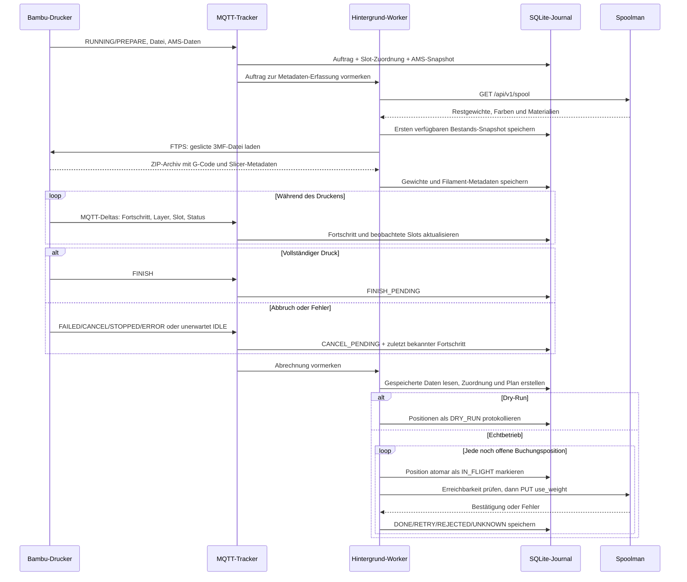
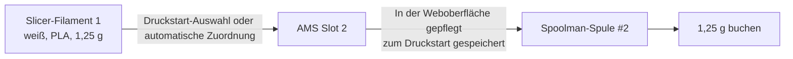

# Kommunikations- und Verarbeitungskonzept

Die Bridge verbindet einen Bambu Lab A1/A1 mini mit AMS Lite mit einer bestehenden Spoolman-Instanz. Sie liest Drucker- und Slicer-Daten, ordnet den Verbrauch den Spulen zu und führt die Bestandsbuchung aus. Sie startet keine Drucke und steuert keinen physischen Spulenwechsel.

## Komponenten und Schnittstellen

| Verbindung | Protokoll | Zweck |
|---|---|---|
| Bridge ↔ Drucker | MQTT über TLS, TCP 8883 | Statusmeldungen, Druckfortschritt, aktive AMS-Slots, Farben und Materialtypen; regelmäßige `pushall`-Statusanforderung |
| Bridge → Drucker | Implizites FTPS, TCP 990 und passive Datenports | Geslicte 3MF-Datei aus dem Drucker-Cache herunterladen |
| Bridge ↔ Spoolman | HTTP REST im gemeinsamen Docker-Netzwerk | Spulen lesen und Verbrauch mit `PUT /api/v1/spool/{id}/use` buchen |
| Browser ↔ Bridge | HTTP, standardmäßig Port 7913 | Zuordnung, Status, manuelle Buchung, Journal und Logs |
| Bridge → persistentes Datenverzeichnis | SQLite und JSON | Aufträge, Fortschritt, Bestands-Snapshots, Buchungsplan, Formularsitzung und Slot-Zuordnung speichern |

Die Druckerverbindungen verwenden den LAN-Zugangscode. Die TLS-Verbindungen sind verschlüsselt; die selbst signierten Druckerzertifikate werden im aktuellen Client nicht gegen eine vertrauenswürdige Zertifikatskette geprüft. Die Bridge benötigt weder Bambu-Cloud-Zugangsdaten noch einen Cloud-Dienst für ihre eigene Verarbeitung.

## Ablauf eines Druckauftrags



Der MQTT-Callback führt keine Downloads oder Bestandsbuchungen aus. Diese Aufgaben übernimmt ein einzelner Hintergrund-Worker. Mehrere Vormerkungen desselben Auftrags werden innerhalb des Prozesses zusammengefasst.

## Woher stammen die Grammwerte?

Der Drucker speichert die geslicte Druckdatei als 3MF-/G-Code-3MF-Archiv. Die Bridge lädt dieses Archiv per FTPS ausschließlich in den Arbeitsspeicher und liest `Metadata/slice_info.config`.

| Feld | Bedeutung in der Bridge |
|---|---|
| `filament.id` | Slicer-Filamentnummer, beginnend bei 1 |
| `filament.used_g` | Vom Slicer angegebener Verbrauch in Gramm |
| `filament.color` | Slicer-Farbe für den automatischen AMS-Vergleich |
| `filament.type` | Materialtyp, z. B. PLA oder PETG |
| Platten-Metadatum `index` | Zuordnung zur tatsächlich gedruckten Platte |

Die Bridge interpretiert nicht jede Extrusionsbewegung des G-Codes und misst keinen realen Filamentdurchfluss. Sie übernimmt die Slicer-Werte. Welche Materialanteile der Slicer darin bereits berücksichtigt, bestimmt die Druckdatei; Kalibrierung oder manuelles Spülen außerhalb dieser Datei werden nicht zusätzlich gemessen.

Bei mehreren Platten muss die Auswahl über `param=Metadata/plate_N.gcode` eindeutig sein. Die Bridge addiert nicht einfach die Gewichte aller Platten. Fehlt die Auswahl, wartet der Auftrag auf eindeutige Metadaten. Standardgrenzen: 200 MiB für das Archiv und 2 MiB für die XML-Metadaten, konfigurierbar über `MAX_3MF_BYTES` und `MAX_XML_BYTES`.

## Zwei Zuordnungen statt einer



Die [3MF- und Farbcode-FAQ](filament-workflow.md#kann-die-3mf-den-verwendeten-ams-slot-verraten) trennt Filamentnummern, Extruder-Mapping und physische AMS-Slots. Insbesondere ist `filament_maps="1 1"` in den untersuchten A1-Dateien keine Liste zweier AMS-Ports, sondern eine Zuordnung beider Filamente zum selben Extruder. Die tatsächliche Druckstart-Zuordnung ist davon getrennt.

`T0`, `T1` oder `M620 S0A` im G-Code bezeichnen nicht verlässlich die physische Slot-Auswahl, die beim Druckstart vorgenommen wird. Deshalb behandelt die Bridge Slicer-Filamentnummern und AMS-Slots getrennt. MQTT-Slots 0–3 entsprechen den sichtbaren AMS-Slots 1–4. `254` steht für die externe Spule, `255` für entladen/kein aktiver Slot. Entladen am Druckende verwirft keine gespeicherte Auftragszuordnung.

Die Zuordnung wird in dieser Reihenfolge ermittelt:

1. Ausdrücklich für den Auftrag bestätigte Zuordnung. Spätere MQTT-Meldungen überschreiben sie nicht.
2. Vom Drucker gelieferte `ams_mapping`-/`ams_mapping2`-Daten, sofern vorhanden.
3. Bei `AUTO_MATCH_FILAMENTS=true`: exakte RGB-Farbe und exakter Materialtyp aus den Slicer-Metadaten gegen den gespeicherten AMS-Bestand.

Es gibt keine Suche nach einer nur ähnlichen Farbe. Die automatische Zuordnung setzt voraus, dass beim Druckstart keine absichtlich abweichende AMS-Farbe gewählt wird. Die externe Spule benötigt eine explizite Zuordnung. MQTT-Deltas erhalten bereits bekannte Attribute, statt fehlende Felder durch Standardwerte zu ersetzen.

### Diagnose bei abweichenden Slicer-Farben

Vertauschte Modellfarben sind grundsätzlich zulässig. Entscheidend sind jedoch die gespeicherten RGB-Werte, nicht nur Farbnamen wie „Grün“. Beispielsweise ist Slicer-PLA `#80FF80` kein exakter Treffer für AMS-PLA `#104831`. Weiß kann dabei korrekt erkannt werden, während Grün offenbleibt. Der gesamte Auftrag wartet dann, damit keine Teilabbuchung erfolgt.

Das Journal und die Auftragsanzeige nennen die konkret nicht passende Slicer-Farbe und das Material. Im Zuordnungsformular werden außerdem die gespeicherten AMS-Farben angezeigt. Eindeutig erkannte Slots sind bereits vorausgewählt. Eine Bestätigung für einen einzelnen Auftrag wird nicht stillschweigend als dauerhaft gültige Farbzuordnung auf spätere Drucke übertragen.

Die Zuordnung **AMS-Slot → Spoolman-Spule** muss beim Spulenwechsel zwischen Drucken aktualisiert werden. Der Auftrag behält seinen gespeicherten Stand; spätere Änderungen leiten bereits geplante oder versuchte Buchungen nicht auf eine neue Spule um.

## Gleichartige Spulen, Auto-Refill und Reserven

Wenn mehrere eingelegte Spulen zur gleichen Farbe und zum gleichen Material passen, werden ausdrücklich zugeordnete und während des Druckens beobachtete Slots bevorzugt. Sonst verwendet die Bridge das kleinste positive gespeicherte Restgewicht zuerst. Die Beobachtung erfolgt anhand aktiver Slots während einer gemeldeten Druckphase mit positivem Layer-Zähler.

Die Aufteilung erfolgt in Hundertstelgramm. Bereits im selben Auftrag reservierte Mengen werden abgezogen, damit zwei Slicer-Filamente nicht dieselben 30 g Restbestand doppelt verplanen.

| Beispiel: 100 g Gesamtverbrauch | Gespeicherter Restbestand | Geplante Buchung |
|---|---:|---:|
| Erste passende Spule | 30 g | 30 g |
| Zweite passende Spule | 100 g | 70 g |

Reichen die passenden AMS-Spulen nicht, werden weitere nicht archivierte Spoolman-Spulen mit exakt derselben Farbe und demselben Material wie das primäre **Spoolman-Filament** einbezogen. Das ist ein eigener Vergleich: Die primäre Slicer→AMS-Zuordnung verwendet die Druckerfarben, die Reservensuche die gepflegten Spoolman-Filamentdaten.

Eine reine Spoolman-Reserve hat keinen bestätigten AMS-Slot. Im Journal steht dann „—“ als Schacht, und die rechnerische Verwendung wird ausdrücklich als unbestätigte Schätzung vermerkt. Sind alle passenden Bestände rechnerisch verbraucht, wird die verbleibende Differenz der letzten passenden Spule belastet und gekennzeichnet.

**Diese Logik ist eine Bestandsaufteilung, keine Messung des tatsächlichen Wechselzeitpunkts.** Auto-Refill muss am Drucker separat eingerichtet sein. Die Bridge schaltet es nicht ein und legt keine Reservespule physisch ein.

## Abbruchschätzung

Für Abbrüche gilt pro Slicer-Filament:

```text
Geschätzter Verbrauch = vollständige Slicer-Grammzahl × letzter Fortschritt / 100
```

Bei 100 g und 40 % werden 40 g geschätzt. Wenn die Abbruchmeldung ihren Fortschritt auf 0 zurücksetzt, bleibt der zuvor gespeicherte höhere Fortschritt erhalten. Dieselbe gespeicherte Fortschrittszahl wird auf alle Slicer-Filamente angewendet; diese Verteilung kann vom tatsächlichen Materialverbrauch abweichen. Bei 0 % entsteht keine positive Buchung, auch wenn bereits Spülmaterial verbraucht worden sein kann.

Das Journal ergänzt den Status um **SCHÄTZUNG** und nennt die Berechnungsbasis in den Details. Die gewichtsbasierte Spulenaufteilung wird ebenso gekennzeichnet.

## Buchungsjournal und Fehlerbehandlung

| Zustand einer Position | Verhalten |
|---|---|
| `UNMAPPED` | Notwendige Zuordnung oder Restgewichte fehlen. Der gesamte Auftrag wartet; noch keine Teilposition wird gebucht. |
| `PENDING` | Position steht im gespeicherten Plan zur Buchung bereit. |
| `IN_FLIGHT` | Die Position ist atomar für einen API-Versuch reserviert. |
| `DONE` | Spoolman hat die Buchung bestätigt. Details: „Buchung durch Spoolman bestätigt“. |
| `RETRY` | Sicherer Wiederholungsfall, z. B. Spoolman vor der Buchung nicht erreichbar oder Verbindungsaufbau-Timeout. |
| `REJECTED` | Spoolman hat die Anfrage abgelehnt; Details enthalten den Fehler. |
| `UNKNOWN` | Der Ausgang ist unklar, etwa nach Antwortverlust, HTTP 5xx oder Neustart während einer laufenden Anfrage. Keine automatische Wiederholung. |
| `DRY_RUN` | Simulation ohne Spoolman-Abbuchung. Auch nach späterem Moduswechsel keine automatische Nachbuchung. |

Die Spoolman-Verbrauchs-API hat keine von dieser Bridge verwendete Idempotenzkennung. Bei unklarem Ausgang wäre eine Wiederholung möglicherweise eine Doppelbuchung. Deshalb ist `UNKNOWN` ein bewusst offener Prüfzustand. Der Buchungsplan bleibt nach dem ersten API-Versuch unverändert; erfolgreiche Teilpositionen werden bei der Wiederaufnahme nicht erneut gebucht. Bei Neustart werden noch als `IN_FLIGHT` gespeicherte Positionen zu `UNKNOWN`.

Ältere erfolgreiche `HTTP 200`-Einträge werden in der Oberfläche ebenfalls verständlich dargestellt. Ihre ursprünglichen gespeicherten Audit-Details werden dabei nicht umgeschrieben. Technische Fehlercodes bleiben für die Fehlersuche erhalten.

## Betrieb, Persistenz und Weboberfläche

- `bridge.sqlite3`: Aufträge, Buchungspositionen, Fortschritt, Bestands-Snapshots und Sitzungsschlüssel.
- `mapping.json`: aktuelle Zuordnung der AMS-Slots und der externen Spule zu Spoolman-Spulen.
- Begrenzter Log-Puffer in der Oberfläche und Docker-Log-Rotation verhindern unbegrenzt wachsende Laufzeitlogs.
- Ein Healthcheck prüft die Anwendung; der separate Spoolman-Status zeigt die API-Erreichbarkeit.
- Manuelle Buchungen und automatische Buchungen verwenden denselben Worker und denselben aktiven Dry-Run-/Echtbetrieb-Modus.
- Formulare haben eine CSRF-Prüfung. Der persistente Sitzungsschlüssel übersteht Container-Neustarts. Optional können Web-Benutzername und Passwort gesetzt werden.
- Das SSH-Deployment baut vor dem Stoppen, sichert den vorhandenen Stand und verweigert Updates während eines erkannten laufenden oder pausierten Drucks. Der bestehende Spoolman wird nicht neu installiert oder ersetzt.

Konfiguration und Startbefehle: [README](../README.md). Versionshistorie: [Changelog](../CHANGELOG.md). Betriebsfreigabe: [Deployment-Protokoll](../DEPLOYMENT.md).
