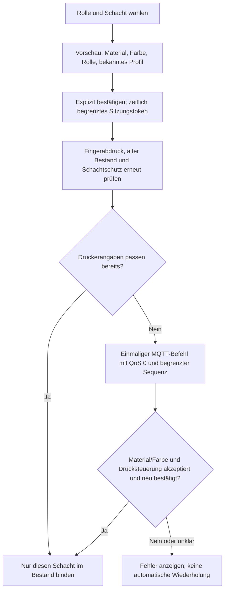

# Architektur und Datenquellen

Stand: 16. November 2026. Bedienabläufe und Screenshots stehen in der [Bedienungsanleitung](user-guide.md), Sicherung und Migration in [Plus-Betrieb](plus-operations.md).

## Komponenten und Verbindungen

| Verbindung | Aufgabe |
|---|---|
| Drucker → Bridge, MQTT/TLS 8883 | Statusdeltas, Fortschritt, Restzeit, AMS-Schächte, aktive/angeforderte Schachtlage und Befehlsantworten |
| Bridge → Drucker, MQTT/TLS 8883 | Vollstatus anfordern, Licht schalten, geprüfte AMS-Metadaten setzen |
| Bridge → Drucker, FTPS 990 und passive Ports | Geslicte 3MF-Datei in den Arbeitsspeicher laden |
| Browser ↔ Bridge, HTTP 7913 | Ansichten, Live-Status und bestätigte Formulare |
| Bridge ↔ SQLite | Aufträge, Buchungspläne, Inventar, Bewegungen, Einstellungen und Sitzungsdaten |
| Bridge ↔ bestehendes Spoolman, optional HTTP REST | Externe Bestandsabfrage und Verbrauchsbuchung ausschließlich im Spoolman-Backend |
| Browser → Bridge → Kamera | Bedarfsgesteuerter unterstützter A1/P1-LAN-Stream |
| Bridge → Tapo-Hilfsprozess → P110 | Schalten und Messwerte; Isolation der nativen Gerätebibliothek |
| Bridge → SpoolmanDB | Öffentliche Produktvorlagen, serverseitig zwischengespeichert |

Der lokale Druckerzugriff benötigt private Zugangsdaten. Die Drucker-TLS-Verbindungen sind verschlüsselt; selbst signierte Zertifikate werden im implementierten Client nicht gegen eine vertrauenswürdige Zertifikatskette validiert. Der Betrieb setzt ein vertrauenswürdiges lokales Netz voraus. Für AMS-Schreiben sind auf der getesteten Firmware LAN-only und Entwicklermodus erforderlich.

## Module

| Modul | Verantwortung |
|---|---|
| `bridge.py` | MQTT-Ereignisse, Aufträge, Planung, Buchungsworker, Webrouten und Vorschauprüfung |
| `printer_telemetry.py` | Deltaerhaltung, Aktualität, Licht- und AMS-Bestätigung einschließlich Ablehnungen |
| `ams_control.py`, `ams_selection.py`, `pressure_advance.py` | Schachtschutz, bekannte Profile, Material-/Farbvergleich, Änderungsfingerabdruck |
| `ams_ui.py`, `device_visuals.py`, `ui.py` | Geprüfter Rollenablauf, eigene SVG-Gerätegrafiken und gemeinsame Oberfläche |
| `inventory_db.py`, `inventory_service.py` | Additives Schema, atomare Bestandsbewegungen und referenzgeschütztes Entfernen |
| `inventory_api.py`, `inventory_ui.py` | Produkt-/Rollenpflege, Korrekturen und verständliche Darstellung |
| `inventory_exchange.py`, `migrate_inventory.py` | Native Exporte/Wiederherstellung und kontrollierter Spoolman-Import |
| `materials.py`, `filament_catalog.py` | Gemeinsame Materialfamilien und optionale Katalogvorlagen |
| `devices.py`, `tapo_worker.py` | Kamera, Licht und isolierte Steckdosenaktionen |
| `auto_power.py` | Auftragsbezogene Abschaltung mit Wartezeit und mehrfacher Prüfung |

## Zwei getrennte Zuordnungsstufen

1. **AMS-Schacht → physische Bestandsrolle:** Welche konkrete Rolle liegt im Schacht? Die App-Rollenübernahme ist der normale Weg. Farbe und Familie allein identifizieren keine Rolle.
2. **Slicer-Filamentposition → AMS-Schacht:** Welches Filament des Druckauftrags verwendet welchen Schacht? Quellen sind ausdrückliche Benutzerbestätigung, Drucker-Mapping oder der exakte Farb-/Materialfamilienvergleich als Fallback.

Ein T0/T1 oder Filamentindex ist kein verbindlicher physischer AMS-Slot. Die beim Start gewählte Zuordnung kann von der Reihenfolge im Slicer abweichen. Die externe Spule wird ausdrücklich zugeordnet.

## AMS-Schreibtransaktion

Die Vorschau ist an Sitzung, Aktion, aktuelle Rolle, vorherige Bindung und relevante Schachtdaten gebunden und gilt 120 Sekunden. Einmalkennungen und gemeinsamer Schreiblock schützen gegen Wiederholung und parallele Überschreibung. Profile und Temperaturen werden aus frischen bekannten Druckerangaben derselben Familie übernommen, nicht erfunden.

Während RUNNING/PAUSE sind aktiver und angeforderter Schacht geschützt. Unbekannte oder veraltete Zustände sperren den Schreibweg. Andere eindeutig inaktive Schächte bleiben verfügbar. Ein relevanter Rollenwechsel setzt einen dauerhaften Prüfvermerk für den Auftrag. Erst eine ausdrückliche Zuordnungsprüfung hebt ihn auf; ursprüngliche Mengenmessungen werden dadurch nicht vorgetäuscht.

## Verbrauchsverarbeitung

Der MQTT-Callback erfasst Status und legt Worker-Aufträge an; er führt keine Downloads oder Bestandsbuchungen aus. Der Hintergrundworker lädt 3MF-Metadaten der ausgewählten Platte, speichert Bestandssnapshots und sammelt beobachtete Schächte. Während RUNNING erfolgt keine Abbuchung.

Nach normalem Ende werden Slicer-Grammwerte verwendet; bei Abbruch werden sie mit dem letzten Fortschritt multipliziert. Fehlende Metadaten oder Zuordnungen halten den gesamten Auftrag offen. Der Plan wird vor dem ersten Buchungsversuch eingefroren. Eine Wiederholung verteilt Mengen nicht neu und bucht bestätigte Positionen nicht erneut.

Die Planung verwendet Hundertstelgramm. Passende AMS-Rollen werden anhand Zuordnung, beobachteter Verwendung und gespeichertem Bestand eingeplant. Rechnerische Aufteilung auf mehrere Rollen oder passende Reserven wird als Schätzung gekennzeichnet. Reserven außerhalb des Druckers erfordern weiterhin exakten gepflegten Materialtyp und Farbwert; eine breite AMS-Familie macht keine Druckparameter austauschbar. Fehlender Bestand wird nicht durch erfundene physische Wechsel erklärt.

### Optionaler Flusszuschlag

Die globale Option wird bei der Erkennung eines neuen Druckauftrags in `settings` unter einem auftragsbezogenen Schlüssel festgeschrieben. Alte Aufträge ohne diesen Wert erhalten keinen rückwirkenden Zuschlag. Je positiver geplanter Slicer-Filamentposition kommen 200 Hundertstelgramm hinzu, bevor die Menge auf Rollen aufgeteilt wird. Der Zuschlag ist nicht pro Reservespule und nicht pro Farbwechsel. Separate gleichfarbige Slicer-Positionen bleiben getrennt.

Bei Abbruch ist nur der Grundverbrauch fortschrittsanteilig; der Zuschlag bleibt pro positiver Position volle 2 g. Bei null positivem Grundverbrauch entfällt er. Die Erklärung steht im Schätzungshinweis des Journals. Die Option ist standardmäßig aus und startet keine Kalibrierung. Frische Stage-8-Meldungen werden dauerhaft pro aktivem Auftrag gespeichert; ein separat eingefrorener Modus beschränkt den Zuschlag bei Bedarf auf diesen positiven Nachweis. `flow_cali` ist als Startparameter dokumentiert; daraus folgt keine bestätigte Statusbeobachtung bei einem fremd gestarteten Druck.

## Buchung nach Backend

### Internes Inventar

SQLite-Transaktionen aktualisieren Restbestand, `consumption_entries`, `inventory_movements` und den bisherigen Buchungsstatus zusammen. Eindeutige Operations- und Quellkennungen verhindern Doppelbuchungen. Bekannter unzureichender Bestand führt zu einer Ablehnung. Der Offline-Umschaltmarker schützt historische Aufträge vor erneuter Belastung. Es gibt keinen automatischen Rückfall auf Spoolman.

Neue Restbestände aus Verbrauch und Korrekturen werden auf zwei Nachkommastellen gerundet. Die Darstellung der AMS-Auswahl verwendet eine Nachkommastelle. Historische Buchungen werden nicht nachträglich gerundet oder neu geschrieben.

### Externes Spoolman

Die REST-Verbrauchs-API bietet hier keine anwendungsseitige Idempotenzkennung. Sichere Fehler vor einer Buchung können erneut geprüft werden; unklare Ergebnisse nach möglichem Schreiben werden UNKNOWN und nicht automatisch wiederholt. Der Plan bleibt erhalten. Die eingebauten Inventar-Editoren sind in dieser Betriebsart nicht schreibend aktiviert.

## Gemeinsames Journal und Historie

Die Anzeige vereinigt Verbrauchspositionen mit manuellen `inventory_movements` vom Typ adjustment. Das erzeugt keine zusätzlichen Verbrauchspositionen und keine doppelte Bewegung. Korrekturen zeigen Vorher/Nachher, Grund und gegebenenfalls Gesamt-/Leerspulengewicht. Datum und Uhrzeit werden gemeinsam dargestellt.

Archivieren erhält aktive Referenzen. „Aus Inventar entfernen“ setzt bei archivierten Rollen einen Entfernungszeitpunkt; die Rolle verschwindet aus operativen Ansichten, historische IDs und Buchungen bleiben bestehen. Aktuelle Schachtbindungen und offene Aufträge verhindern das Entfernen. Andere Rollen desselben Produkts sind unabhängig.

## Geräte und automatische Abschaltung

Lichtaktionen erfordern eine neue passende `lights_report`-Meldung. Erfolgreicher MQTT-Versand allein reicht nicht. Lichtstatus bestimmt nicht, ob ein Druck aktiv ist.

Manuelles Ausschalten setzt verbundenen Drucker und explizites IDLE/FINISH mit höchstens 30 Sekunden alten Daten voraus. Veraltete Daten werden neu angefordert; der Tapo-Prozess prüft unmittelbar vor dem Schalten erneut.

Die automatische Abschaltung ist eine zusätzliche, standardmäßig deaktivierte pro-Auftrag-Option. Sie wartet auf normales Ende, erfolgreich erledigte Buchung und 60/120/180 Sekunden Verzögerung. Eine neue Statusanforderung und eine finale Prüfung desselben Auftrags und der weiterhin aktivierten Option gehen dem Schalten voraus. Neuer Druck, Abbruch, unklarer Ausgang oder Neustart während des Schaltversuchs verhindern Wiederholungen. Sie kontrolliert keine Temperatur.

## Sicherungen und Prüfbarkeit

SQLite-Backup-API für eine konsistente laufende Kopie verwenden; laufende Hauptdatei nicht ohne WAL-/SHM-Beachtung kopieren. Vollbackup umfasst zusätzlich private Konfiguration, kompletten Quellstand, Containerdefinition und vorheriges Image. Testimport und Migration erfolgen nur mit separater Kopie und gestopptem produktivem Schreiber.

Native JSON-Exporte erhalten Inventarhistorie und relevante Auftragsprüfvermerke, aktivieren aber keine automatische Abschaltung beim Restore. Vollständige SQLite-Sicherungen enthalten auch Laufzeitzustände. Vor Freigabe nach Wiederherstellung offene Aufträge, Betriebsmodus und Abschaltoption prüfen.

[Hardwarestand und Tests](../DEPLOYMENT.md) · [Kommunikationsdiagramm](flows/communication.md) · [Verarbeitungsdiagramm](flows/processing.md).

## Dynamische Drucksteuerung

`extrusion_cali_get` liefert die gespeicherten Profile zur gemeldeten Düse. Die App erfindet weder Index noch K-Wert. `extrusion_cali_sel` wählt einen vorhandenen Index im exakten Filamentvorlagen-/Düsenkontext; Index -1 bezeichnet keine gespeicherte Profilauswahl. Für einen anderen bekannten Vorlagenkontext werden ausschließlich aktuelle bereits vom Drucker bekannte Material-/Temperaturangaben verwendet. Gespeicherte Profilauswahlen werden vor Vorschau und Übertragung frisch gelesen; Name, K-Wert, Index und Kontext sind Bestandteil des Vorschau-Fingerabdrucks.

Nach bestätigtem `ams_filament_setting` wird der Schachtschutz erneut geprüft, bevor `extrusion_cali_sel` gesendet wird. Die App verlangt dessen Befehlsantwort und einen neuen Schachtbericht mit passendem `cali_idx`, bei gespeichertem Profil auch passendem K-Wert. Alte passende Werte genügen nicht. Ein Teilergebnis verändert möglicherweise Drucker-Metadaten, wird aber nicht als vollständiger Erfolg oder als neue Bestandsbindung ausgegeben. Es wird kein Rücksetz-/Wiederholungsbefehl automatisch geraten.

### Vorschaubilder und Darstellung

Der FTPS-Vorschauleser verarbeitet ZIP-Lokalheader sequenziell, einschließlich Datenbeschreibungen für zunächst unbekannte Größen und ZIP64. Nach einem durch CRC und Größenangaben bestätigten PNG-/JPEG-Bild werden Daten- und Steuerverbindung geschlossen. So bleiben nachfolgende große G-Code-Einträge unübertragen; REST ist nicht erforderlich. Pro Versuch sind gelesener Archivanfang, entpackte Bytes, Bildgröße und Laufzeit begrenzt. Geänderte Dateiangaben verlangen weiter eine neue Auswahl. Das Ergebnis gelangt in den getrennten persistenten Bildcache. Inventar und Buchungsjournal werden nicht verändert.

Das gemeinsame Seitengerüst bietet einen hellen und einen dunklen Variablensatz. Die Präferenz wird ausschließlich im Browser gespeichert und vor dem ersten Seitenaufbau angewendet. Der Wechsel verändert nur die Darstellung, nicht Materialfarben, Druckerzustand oder Servereinstellungen.

### Geprüfter Druckstart und Metadaten

Ein einzelner Hintergrundleser lädt das gewählte begrenzte Druckarchiv in eine temporäre Datei, prüft Konfigurationen, reale Plattennummern und Filamentpositionen und verwirft das Archiv anschließend. Ein separater begrenzter Metadatencache speichert nur die ausgewerteten Daten und kleinen Plattenbilder. Die Startprüfung verknüpft Dateiauswahl, Druckplatte, Optionen, Düse und aktuelle AMS-/Bestandsbindungen über einen Fingerabdruck und ein einmaliges serverseitiges Token. Unmittelbar vor project_file werden Datei und Zustand erneut geprüft. AMS-Schreibsperre und persistenter Kurzzeitmarker verhindern parallele beziehungsweise wiederholte unklare Starts. Ein frischer passender Druckerstatus bestätigt den Beginn; reine Veröffentlichung des MQTT-Befehls genügt nicht.

Nach einer passenden positiven project_file-Rückmeldung werden die geprüfte Druckplatte, Grammwerte und bestätigte Zuordnung noch vor dem ersten Auftragsworker gespeichert. Dadurch ist für einen aus der App gestarteten Auftrag kein zweiter Archivdownload während des Druckbeginns nötig. Ohne passende Rückbestätigung bleiben die bisherigen sicheren Metadaten-/Zuordnungswege erhalten.

### Lokale Einstellungen, frühe Metadaten und Dateinamen

Private Gerätewerte werden außerhalb des Inventars in einer atomar geschriebenen 0600-Datei gespeichert. Die GUI benötigt dafür keine zusätzliche Anmeldung; bestehender optionaler Webschutz und CSRF-Prüfung gelten weiter. Eine Leerlauf-/Zugriffssperre schützt die Konfigurationsänderung. Der Dienst übernimmt sie bei einem kontrollierten Neustart; neue Druckstarts sind während einer ausstehenden Übernahme gesperrt. Infrastruktur- und Backendwerte sind nicht Teil dieser GUI-Konfiguration.

Ein begrenzter paralleler Archivleser kann bereits vor dem G-Code anhand geprüfter Projekt-/Platteneinträge einen vorläufigen Vorschlag liefern. Diese Daten entsperren keinen Start und werden nicht als Buchungsgrundlage übernommen. Die vollständige `slice_info.config` bleibt maßgeblich; eine fehlende Vorab-Erkennung lässt den bisherigen geprüften Vollimport unverändert weiterlaufen.

Umbenennen nutzt RNFR/RNTO innerhalb des bisherigen Speicherbereichs, mit erneuter Datei-/Leerlaufprüfung, Kollisionsprüfung und Kontrolle des Ergebnisses. Metadaten und Bilder werden dem neuen Dateifingerabdruck zugeordnet; eine separate Aliasliste verbindet historische Namen. Buchungs- und Inventardaten werden nicht umgeschrieben. Der alte interne Verbindungsstatus und seine periodischen, sonst ungenutzten Bestandsabfragen entfallen.

## Kosten-Snapshots und Auftragsenergie

Inventarschema 5 ergänzt `spools.price_weight_g`, drei Preissnapshot-Spalten in `consumption_entries` sowie `job_costs`. Die Preisübernahme erfolgt innerhalb derselben Transaktion wie Bestandsänderung, Bewegung und Verbrauchseintrag. Der idempotente Wiederholungspfad ändert den Snapshot nicht. Preise werden als Centbetrag, Kostenberechnungen mit Decimal und Ausgabe auf Cent geführt; unbekannte und fremdwährungsbasierte Werte ergeben keine behaupteten Eurokosten.

`print_costs.py` hält je Auftrag einen eingefrorenen Stromtarif, Beginn/Ende, kumulierte Energie, abgedeckte Dauer und den letzten Messpunkt. Der separate Messdienst verwendet denselben Tapo-Lesezugriff und dieselbe Sperre wie die Oberfläche; kein Netzwerkzugriff aus einer Inventartransaktion oder dem MQTT-Callback. Die Messung integriert frische, aufeinanderfolgende Leistungswerte mit begrenzten Abständen. Unterbrechungen löschen die Interpolationskontinuität. Geschlossene Messungen nehmen keine späteren Werte an. Kostenfehler werden von der Verbrauchsverarbeitung isoliert. Native Exporte enthalten die Snapshots und Messstände; Konfigurationsgeheimnisse bleiben ausgeschlossen.

Inventarschema 6 ergänzt `job_cost_estimates` für ausdrücklich beauftragte historische Referenzrechnungen. `historical_costs.backfill_history` arbeitet standardmäßig als Vorschau und schreibt bei explizitem `apply=True` ausschließlich diese Tabelle unter einer Schreibtransaktion. Quelle, Ersatzannahmen, Preis-/Energieergebnis und Erstellungszeit werden je Auftrag gespeichert; bestehende Verbrauchs- und Mess-Snapshots bleiben unverändert. Vollständig bewertete Aufträge, laufende Aufträge und Simulationen werden übersprungen. Die Präsentation bevorzugt vollständige Originalkosten und kennzeichnet eine alternativ verfügbare Rückrechnung ausdrücklich.
