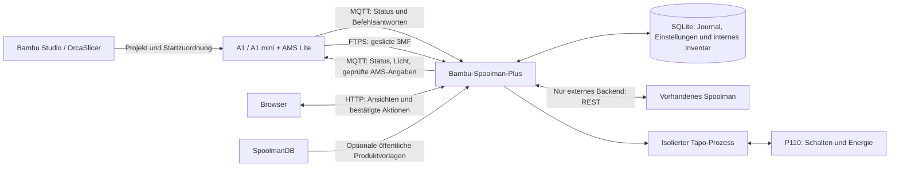

# Kommunikationsflow

Interner und externer Bestandsweg sind alternative Betriebsarten; es gibt keinen automatischen Rückfall. AMS-Schreiben erfordert LAN-only und Entwicklermodus. [Architektur](../architecture.md) · [Zur Übersicht](../../README.md).
