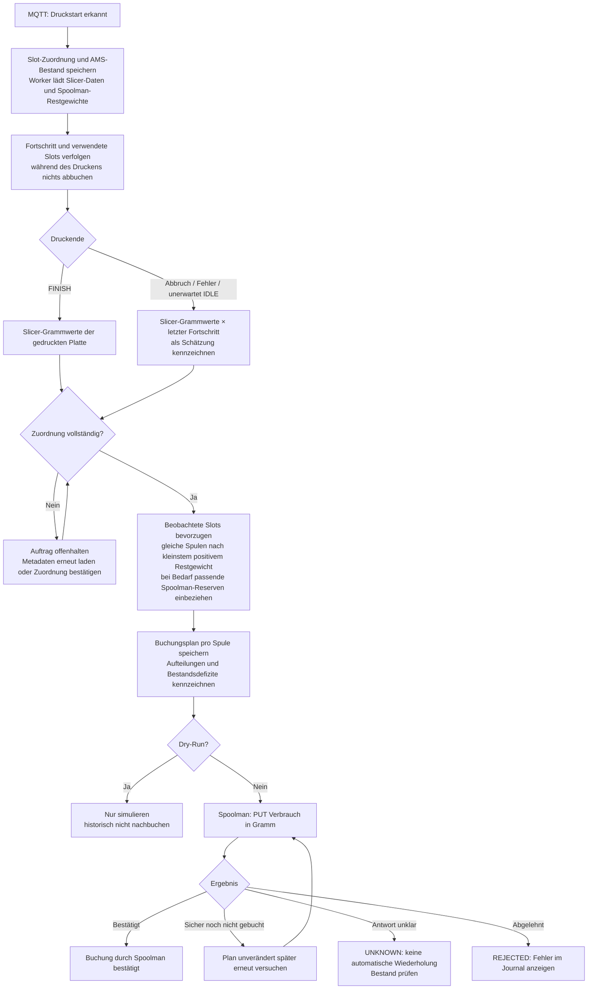

# Verarbeitungsflow

Verarbeitung vom Druckstart bis zur bestätigten Buchung oder Fehlerbehandlung.

Dieses Dokument enthält nur diesen Flow. Über die Diagrammansicht auf GitHub lässt er sich unabhängig vergrößern und zoomen.

[Zurück zur Übersicht](../../README.md#kommunikation-und-verarbeitung)
