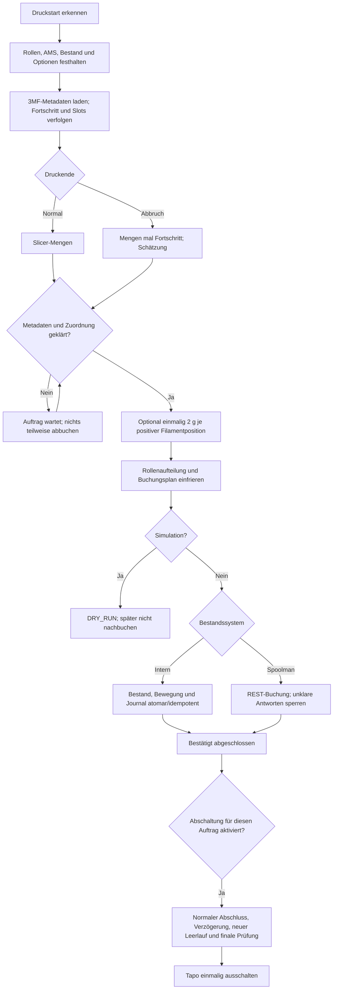

# Verarbeitungsflow

Offene Prüfungen, neuer Druck und Abbruch verhindern die automatische Abschaltung. Das Diagramm fasst den Erfolgsweg zusammen; externe UNKNOWN-/RETRY-Zustände erläutert die [Architektur](../architecture.md). [Zur Übersicht](../../README.md).
