# Bedienungsanleitung

Bambu-Spoolman-Plus verbindet lokale Druckerüberwachung, AMS-Zuordnung, Filamentbestand, Verbrauchsjournal, Kamera und eine Tapo-P110-Steckdose. Diese Anleitung beschreibt den Stand vom 16. November 2026. Die Abbildungen zeigen die tatsächlich gerenderte aktuelle Oberfläche mit ausschließlich künstlichen Beispieldaten. Sie sind keine Hardwaremessungen und enthalten keine privaten Bestände.

## Inhalt

- [Voraussetzungen und Druckermodus](#voraussetzungen-und-druckermodus)
- [Drucker und Verbrauch](#drucker-und-verbrauch)
- [Spulen im AMS Lite](#spulen-im-ams-lite)
- [Filamente und physische Spulen](#filamente-und-physische-spulen)
- [Wiegen und Bestandskorrektur](#wiegen-und-bestandskorrektur)
- [Löschen und Archivieren](#löschen-und-archivieren)
- [Journal und offene Druckaufträge](#journal-und-offene-druckaufträge)
- [Druckerspeicher](#druckerspeicher)
- [Kamera und Licht](#kamera-und-licht)
- [Steckdose und Energie](#steckdose-und-energie)
- [Automatisch nach dem Druck ausschalten](#automatisch-nach-dem-druck-ausschalten)
- [Einstellungen und Flusskontrolle](#einstellungen-und-flusskontrolle)
- [Fehlersuche und Grenzen](#fehlersuche-und-grenzen)

## Voraussetzungen und Druckermodus

### Für Material- und Farbübertragung an das AMS

Am kompatiblen Bambu A1/A1 mini müssen **LAN-only-Modus und Entwicklermodus (Developer Mode)** eingeschaltet sein, damit die App auf der getesteten Firmware Material und Farbe direkt an das AMS schreiben kann. Die Bezeichnung und Position der Schalter können je nach Firmware abweichen. Den Moduswechsel nach Druckende am Drucker vornehmen; die App ändert den Betriebsmodus nicht selbst.

1. Am Drucker die Netzwerkeinstellungen öffnen und LAN-only aktivieren.
2. Den Entwicklermodus aktivieren, soweit als separater Schalter vorhanden.
3. Für die Kamera gegebenenfalls LAN-Livebild aktivieren.
4. Den aktuell gültigen LAN-Zugangscode ausschließlich in der privaten Serverkonfiguration hinterlegen. Nach einem Moduswechsel kann sich der Code ändern.
5. Die App-Verbindung prüfen und zunächst einen inaktiven Schacht im Leerlauf testen.

LAN-only verändert die bisherige Bambu-Cloud-/Handy-Nutzung. Für den lokalen Studio-Zugriff müssen Rechner und Drucker miteinander erreichbar sein. Entwicklerzugriff gehört in ein vertrauenswürdiges lokales Netz; Geräteports nicht ins Internet freigeben. Bambu beschreibt die offenen lokalen MQTT-, Kamera- und FTP-Schnittstellen in seiner [Erklärung zum Entwicklermodus](https://blog.bambulab.com/updates-and-third-party-integration-with-bambu-connect/).

Für die Bridge werden Docker Compose v2, ein persistentes Datenverzeichnis und erreichbare Druckerports benötigt: MQTT/TLS 8883, implizites FTPS 990 einschließlich passiver Datenports und der unterstützte LAN-Kamerastream. Individuelle Adressen, Codes und Passwörter gehören ausschließlich in die private Konfiguration.

### Bestandssystem

Es gibt zwei Betriebsarten: den bestehenden Spoolman-REST-Bestand und das integrierte SQLite-Inventar. Die vollständige Produkt-, Spulen- und Korrekturverwaltung dieser Anleitung setzt das **kontrolliert aktivierte interne Inventar** voraus. Die App fällt nicht automatisch auf ein anderes Bestandssystem zurück. Ein Wechsel erfordert vollständige Sicherungen, einen Testimport und die Offline-Umschaltung nach [Betrieb und Wiederherstellung](plus-operations.md); eine Umgebungsvariable allein genügt nicht.

## Drucker und Verbrauch

Die Übersicht zeigt Inventarverbindung, Druckerzustand, Fortschritt, Datei, aktiven Schacht und voraussichtliche Restzeit. Die Restzeit stammt vom Drucker und wird nicht aus dem Prozentfortschritt hochgerechnet. Fehlende oder länger als drei Minuten veraltete Zeitangaben werden nicht als aktuelle Prognose angezeigt. Nach Abschluss steht „Abgeschlossen“; offline wird keine alte Restzeit weiterverwendet.

Während des Drucks sammelt die App Metadaten und beobachtete Schächte. Sie bucht den Verbrauch erst nach dem Ende. Die Grammwerte stammen aus der ausgewählten Druckplatte der geslicten 3MF-Datei; sie sind keine Wägung des tatsächlich extrudierten Materials.

Die A1-Abbildung ist eine eigene schematische Darstellung. Eine gesunde Anwendung kann einen ausgeschalteten oder nicht erreichbaren Drucker als offline anzeigen: Anwendungs-Health und Druckerverbindung sind verschiedene Zustände.

## Spulen im AMS Lite

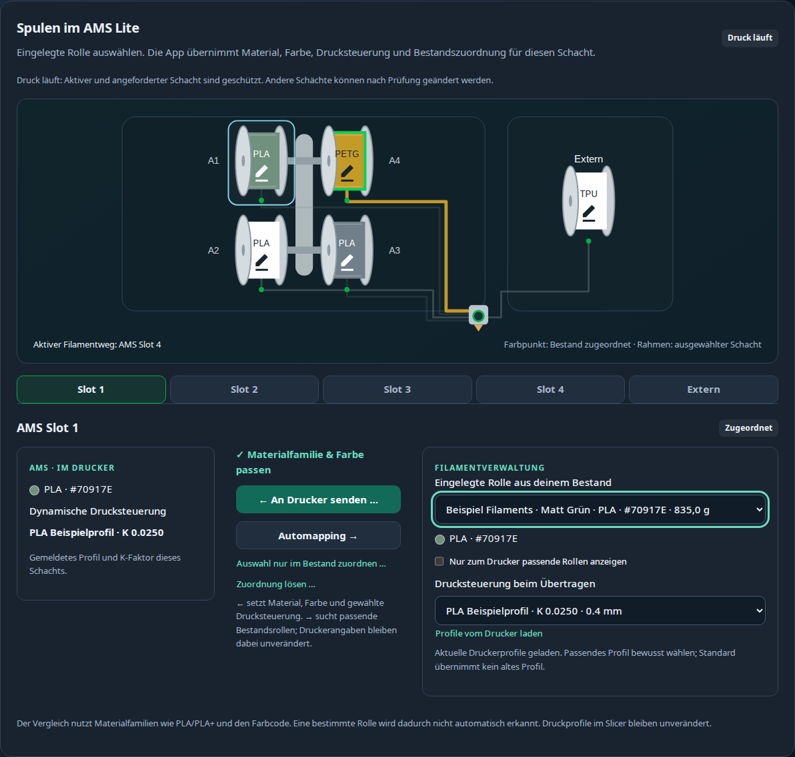

### Normaler Rollenwechsel über die App

1. Physische Rolle im gewünschten Schacht wechseln.
2. Den Schacht in der Grafik oder über Slot 1–4 auswählen. Die Grafik zeigt die Spulen mit grauen Flanschen dicht am zentralen Ständer und ordnet A1/A4 oben sowie A2/A3 unten an; die externe Spule steht daneben.
3. Im Auswahlfeld die **konkrete Bestandsrolle** auswählen. Gleiche Produkte können mehrere unabhängige Rollen besitzen.
4. Rechts die gewünschte Drucksteuerung wählen: Standard oder ein vorhandenes passendes Profil. Dann „← An Drucker senden …“ öffnen. Die Auswahl allein sendet noch keinen Befehl.
5. Unter „Änderung prüfen“ bisherige und geplante Farbe, Materialfamilie, Rolle und gegebenenfalls bekanntes Druckerprofil prüfen.
6. Die geprüfte Übertragung bestätigen. Der Transfer übernimmt Material, Farbe und diese Profilauswahl; die Bestandsrolle wird erst nach Bestätigung beider Druckerbefehle gebunden. Für eine reine Bestandsbindung stattdessen „Automapping →“ beziehungsweise „Auswahl nur im Bestand zuordnen …“ nutzen.

Die App ist damit der primäre Weg für den Rollenwechsel. Die Grafik zeigt bestätigte Druckerwerte, keine ungespeicherten Entwürfe. Der Auswahlrahmen bezeichnet den geöffneten Schacht; der farbige Filamentweg bezeichnet den gemeldeten aktiven Schacht. Auswahl und tatsächliche Nutzung sind unabhängig.

Schreibbefehle verwenden ein aktuelles, vom Drucker bereits bekanntes Profil derselben Materialfamilie einschließlich gültiger Temperaturangaben. Profilkennungen und Temperaturen werden nicht geraten. Ohne geeignetes Profil den Materialtyp zunächst über Bambu Studio bereitstellen. Eine Metadatenänderung lädt oder entlädt kein Filament und verändert keine Slicer-Druckprofile.

### Dynamische Drucksteuerung / K-Profil

Der Unterbereich zeigt links die **AMS-Werte einschließlich gemeldeter Drucksteuerung und K-Faktor**, rechts die Bestandsrolle und die gewünschte Drucksteuerung. In der Mitte stehen die Übertragungsrichtungen. Auf kleinen Bildschirmen folgt auf die Druckerkarte zuerst die Rollenauswahl und dann die Aktionsgruppe.

Der Material-/Farbbefehl allein ersetzt keine dynamische Drucksteuerung. Beim Wechsel der Bestandsspule wird deshalb auf der rechten Seite nicht unbemerkt das vorherige Profil übernommen. Die gewünschte Auswahl ist bewusst zu treffen:

- **Standard · kein gespeichertes Profil:** Löst die Zuordnung zu einem gespeicherten K-Profil über die Druckerfunktion. Es wird kein K-Wert erfunden oder auf null geschrieben; der vom Drucker gemeldete effektive K-Wert kann weiterhin angezeigt werden.
- **Vorhandenes Druckerprofil:** Über „Profile vom Drucker laden“ werden Namen, K-Werte und Düsendurchmesser abgefragt. Nur passende Materialvorlagen mit bekanntem aktuellem Druckerkontext können übertragen werden. Ein bloß ähnlicher Name oder dieselbe Farbe genügt nicht.

Die Profilliste wird vor Vorschau und Bestätigung einer gespeicherten Auswahl neu geprüft. Geänderte oder neu nummerierte Einträge machen die Vorschau ungültig. Die App erstellt, löscht oder kalibriert keine Profile und ändert keinen Flussfaktor im Slicer. Der Drucker muss ein geeignetes Profil bereits besitzen; bei fehlender Materialvorlage diese zunächst in Bambu Studio bereitstellen.

Beim Transfer folgen zwei getrennte Befehle: Material/Farbe und Auswahl der dynamischen Drucksteuerung. Erfolg erfordert für beide eine Befehlsbestätigung und neue passende Schachtwerte, bei einem gespeicherten Profil zusätzlich den erwarteten K-Wert. Erst dann wird die Rolle im Bestand gebunden. Falls nur Material/Farbe bestätigt wurde, zeigt die App ausdrücklich den Teilerfolg an und fordert eine Zustandsprüfung; keine automatische Wiederholung. Der aktive und der angeforderte Schacht bleiben für beide Befehle geschützt.

Die dynamische Drucksteuerung ist unabhängig vom pauschalen 2-g-Verbrauchszuschlag unter Einstellungen. Die Auswahl startet keinen Kalibrierungsdruck. Technische Referenz: [Bambu Studio – DeviceManager.cpp](https://github.com/bambulab/BambuStudio/blob/master/src/slic3r/GUI/DeviceManager.cpp) (`command_get_pa_calibration_tab`, `commnad_select_pa_calibration`).

### Bestätigung, Zeitbedarf und Sicherheit

Eine Vorschau gilt zwei Minuten. Geänderte Rollen-, Schacht- oder Zuordnungsdaten verlangen eine neue Prüfung. Die App prüft die Antwort auf den konkreten MQTT-Befehl **und** passende neue Zustandsdaten. Vorübergehend leere oder erneut befüllte Schachtmeldungen müssen sich stabilisieren. Die Bestätigung kann deshalb einige zehn Sekunden dauern.

Ein bloß erfolgreich gesendeter Befehl oder eine unveränderte passende Altfarbe genügt nicht als Erfolg. Bei unklarem Ergebnis nicht wiederholt klicken: tatsächlichen Druckerstand prüfen und eine neue Vorschau öffnen. Die App wiederholt solche Schreibversuche nicht selbstständig. Andere Schächte bleiben bei einer Einzeländerung unverändert.

### Änderungen während eines Drucks

Bei frischem, eindeutigem Druckerstatus dürfen **andere, inaktive Schächte** geändert werden. Gesperrt sind der aktive Schacht und der bereits zum Filamentwechsel angeforderte Schacht. Bei unbekannter Slotlage, Offline-Zustand oder nicht ausreichender Aktualität bleibt die Schreibaktion gesperrt. Auch pausierte Drucke schützen die benötigten Schächte.

Ändert sich eine für den laufenden Auftrag relevante Bestandsrolle, wartet dessen automatische Buchung auf eine ausdrückliche Zuordnungsprüfung. Gespeicherte Rollensnapshots werden nicht stillschweigend ersetzt. Eine nachträglich bestätigte Rollenaufteilung bleibt eine Schätzung; die App misst keine rollenbezogenen Teilmengen beim Wechsel.

Die Schachtfreigabe während eines Drucks ist durch automatisierte und Browserprüfungen abgedeckt. Der echte Farbwechsel nach Aktivierung des Entwicklermodus wurde bisher im Leerlauf geprüft; ein solcher Farbwechsel während eines laufenden Drucks ist noch nicht physisch bestätigt.

### Fallback für Änderungen in Bambu Studio oder am Drucker

Der Filter „Nur zum Drucker passende Rollen anzeigen“ ist dauerhaft unter der Rollenauswahl sichtbar. Standardmäßig stehen alle aktiven Bestandsrollen zur Verfügung. „Automapping →“ sucht anhand der gemeldeten Materialfamilie und exakten Farbe: Bei genau einem Treffer wird eine reine Bestandszuordnung zur Bestätigung vorbereitet; bei mehreren Treffern muss die tatsächliche Rolle ausgewählt werden. „Auswahl nur im Bestand zuordnen …“ verbindet die gewählte Rolle mit dem vorhandenen Druckerstand. Eine bewusste Abweichung muss zusätzlich bestätigt werden. „Zuordnung lösen …“ betrifft nur den ausgewählten Schacht. Die externe Spule wird hier ausschließlich im Bestand zugeordnet.

Ein gemeldeter Wechsel von Material, Farbe oder Belegung kann eine alte Zuordnung für künftige Aufträge lösen. Identische Rollen mit identischen Druckerangaben lassen sich ohne gemeldete Leerphase nicht unterscheiden; diesen Wechsel ausdrücklich selbst zuordnen.

### Materialfamilien

PLA-Varianten wie PLA+, PLA Meta und PLA-CF lassen sich mit der AMS-Kategorie PLA abgleichen; PETG-Varianten wie PETG-CF oder PETG-HF entsprechend mit PETG. Die exakte RGB-Farbe bleibt erforderlich. Eine Familie bedeutet keine Austauschbarkeit von Temperaturen, K-Faktor, Fluss oder Druckprofil. Der Filamenttyp im Bestand darf seine genauere Bezeichnung behalten. Die automatisch abgeleitete AMS-Kategorie wird in der Produktverwaltung angezeigt.

## Filamente und physische Spulen

Ein **Filamentprodukt** beschreibt Hersteller, Bezeichnung, Typ und Farbe. Eine **physische Spule** ist eine bestimmte Rolle dieses Produkts mit eigenem Lagerort, Restbestand, Leergewicht und gegebenenfalls Charge. Zwei gleiche Rollen teilen das Produkt, aber nicht ihre Bestände oder Schachtzuordnungen.

1. Unter „Filamente“ zunächst nach vorhandenem Produkt suchen; Material-, Hersteller- und Statusfilter nutzen.
2. Ein fehlendes Produkt im Reiter „Filamentprodukte“ anlegen. Die Bezeichnung enthält den gewünschten Farbnamen. Der Filamenttyp darf beispielsweise PLA+ oder PETG-CF heißen.
3. Reines Filamentgewicht einer vollen Rolle und **Leerspulengewicht** getrennt pflegen. „Sonstiges“ enthält freie Zusatzangaben. Durchmesser und Dichte stehen unter weiteren Angaben.
4. Fehlt der Hersteller, im selben Dialog „Neuen Hersteller anlegen“ wählen und den Namen eingeben. Hersteller und Produkt werden zusammen gespeichert; bereits ausgefüllte Felder bleiben erhalten.
5. Danach „Spule hinzufügen“: Produkt, Lagerort und tatsächlichen Eröffnungsbestand auswählen. Leer lassen bedeutet „unbekannt“, nicht null.
6. Die konkrete Rolle dem AMS-Schacht zuordnen.

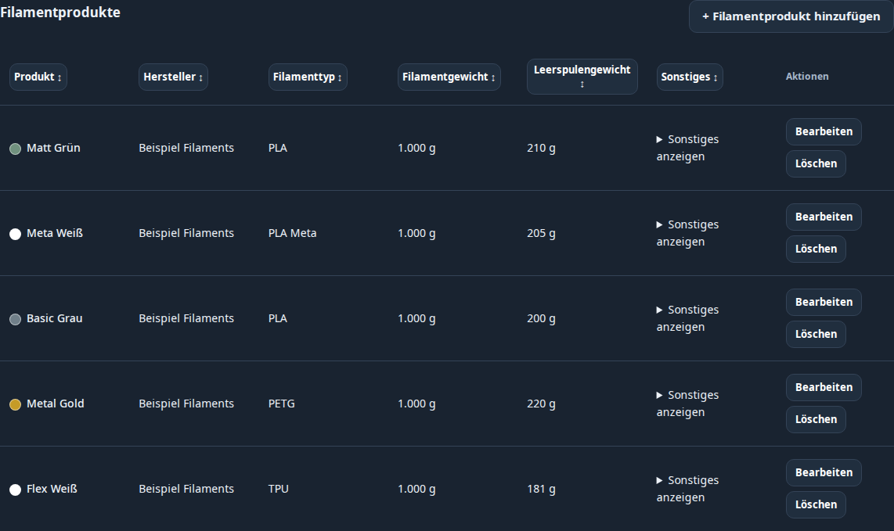

Artikelnummer, separater Farbname und Variante sind keine nötigen Eingabefelder mehr. Frühere Werte bleiben gespeichert. „Sonstiges“ ist aufklappbar, damit Bearbeiten und Löschen gut erreichbar bleiben. Tabellenüberschriften sortieren auf- und absteigend; Gewichte werden numerisch sortiert. Die AMS-Rollenauswahl zeigt Gewichte mit einer Nachkommastelle. Neu berechnete Restbestände bei Buchungen und Korrekturen werden auf zwei Nachkommastellen gerundet; historische Buchungen werden nicht nachträglich umgeschrieben.

### Optionaler Filamentkatalog

Bei neuen Produkten kann „Mit Vorlage aus dem Katalog starten“ die Stammdaten aus **SpoolmanDB** übernehmen. Nach Hersteller, Material oder Produkt suchen, Treffer wählen, Werte prüfen und speichern. Die Vorlage kann einen fehlenden Hersteller mit anlegen. Bestehende Produkte für zusätzliche Rollen wiederverwenden.

Die App verwendet derzeit keinen automatischen Import von 3dfilamentprofiles.com. SpoolmanDB wird als öffentliche JSON-Datei geladen und serverseitig durchsucht; der Suchbegriff wird nicht als Anfrage an einen externen Suchdienst gesendet. Der Cache bleibt sechs Stunden im Speicher. Bei Ausfällen kann ein älterer Cache weiterhelfen, andernfalls bleibt die manuelle Anlage verfügbar.

Übernommen werden Stammdaten einschließlich Herkunft und Originaldatensatz. Es gibt keine automatische Aktualisierung vorhandener Produkte und keine Übertragung von Slicer-Profilen. Ein Katalogeintrag ersetzt keine Temperatur-, Fluss- oder K-Faktor-Kalibrierung.

## Wiegen und Bestandskorrektur

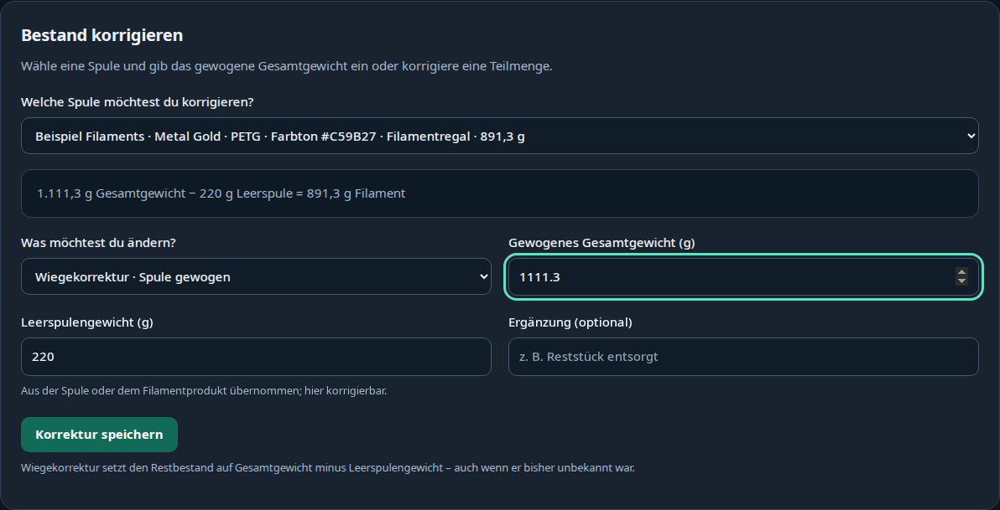

1. Bei der konkreten Rolle „Bestand korrigieren“ öffnen.
2. „Wiegekorrektur · Spule gewogen“ auswählen.
3. Das **Gesamtgewicht von Spule und Filament** eingeben.
4. Das vorgeschlagene Leerspulengewicht prüfen: zuerst das individuelle Spulengewicht, sonst der Produktstandard. Fehlendes Leergewicht ergänzen.
5. Vorschau prüfen, Grund beziehungsweise Ergänzung eintragen und speichern.

Beispiel: 1.111,3 g Gesamtgewicht − 220 g Leerspule = 891,3 g Filament. Die App rechnet selbst. Auch zuvor unbekannter Bestand kann so erstmals gesetzt werden. Eine Änderung des Produkt-Nenngewichts allein korrigiert keinen vorhandenen Restbestand.

Alternativ „Filament hinzufügen“ oder „Filament abziehen“ mit positiver Teilmenge verwenden. Korrekturen erscheinen mit Datum, Vorher-/Nachherbestand und Grund im gemeinsamen Journal; Wiegekorrekturen zusätzlich mit Gesamt- und Leergewicht. Sie werden nicht als Druckverbrauch gezählt. Simulation ist kein Schutzschalter für diese absichtlichen Inventarkorrekturen.

## Löschen und Archivieren

| Aktion | Zweck und Auswirkung |
|---|---|
| Archivieren | Rolle aus dem aktiven Bestand nehmen; Datensatz und Historie bleiben erhalten. |
| Löschen | Unbenutzte Einträge endgültig löschen, sofern keine Referenzen bestehen. Produkte mit vorhandenen Rollen bleiben geschützt. |
| Aus Inventar entfernen | Archivierte Rolle aus Listen, Zählern und Auswahlfeldern ausblenden; historischer Datensatz und Buchungen bleiben erhalten. |

Für eine archivierte Rolle mit Historie ist **„Aus Inventar entfernen“** der richtige Weg. Zuerst aktuelle AMS-Zuordnungen lösen und offene Druckaufträge beziehungsweise Zuordnungsprüfungen klären. Alte abgeschlossene Drucke verhindern das Entfernen nicht. Die andere Rolle desselben Produkts bleibt unabhängig erhalten.

Entfernte Rollen können nicht erneut ausgewählt, bearbeitet oder reaktiviert werden. Vollständige Inventarexporte enthalten ihre historischen Datensätze weiterhin. Die Bestätigungsfrage vor dem Entfernen erläutert die Folgen.

## Journal und offene Druckaufträge

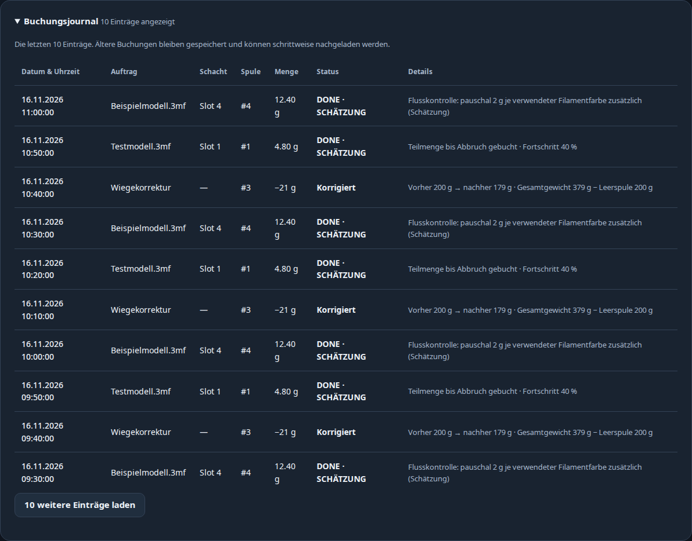

Das Journal zeigt zunächst die **letzten zehn Einträge** mit Datum und Uhrzeit, Auftrag, Schacht, Rolle, Menge, Status und Details. „10 weitere Einträge laden“ ergänzt jeweils die nächste Seite. Wenn keine älteren Einträge übrig sind, verschwindet die Schaltfläche. Die vollständige Historie bleibt in der Datenbank gespeichert; es gibt keine automatische Löschung alter Buchungen.

Über die Überschrift lässt sich der gesamte Bereich wie die Diagnose einklappen. Der Browser merkt sich diesen Zustand lokal. Beim Blättern bleiben bereits geladene ältere Einträge stehen. Neue Buchungen werden dann über „Aktuelle Einträge anzeigen“ erreichbar; diese Aktion kehrt zur neuesten Zehneransicht zurück. Fehlgeschlagenes Nachladen kann wiederholt werden, ohne die vorhandenen Einträge zu verlieren. Erfolgreiche interne Buchungen aktualisieren Bestand und Verbrauch gemeinsam in einer SQLite-Transaktion. Wiederholtes FINISH oder eine Wiederaufnahme erzeugen keine zweite Buchung derselben Position.

Bei Abbruch lautet der Hinweis „Teilmenge bis Abbruch gebucht“. Die Grundlage bleibt Slicer-Menge × letzter bekannter Fortschritt. Das ist insbesondere bei Mehrmaterial keine genaue Extrusionsmessung. Bei null geschätztem Verbrauch entsteht keine positive Buchung. Rechnerische Aufteilungen auf Rest- oder Reservespulen werden ebenfalls gekennzeichnet.

| Zustand | Bedeutung / nächster Schritt |
|---|---|
| RUNNING | Daten werden gesammelt; noch keine Verbrauchsabbuchung. |
| WAITING_METADATA | Eindeutige Verbrauchs-/Platteninformationen fehlen; Datei und Erreichbarkeit prüfen. |
| CLOSED_NO_USAGE | Ohne Verbrauchsbuchung ausdrücklich geschlossen; möglicher Materialverbrauch bleibt unbeziffert. |
| WAITING_MAPPING | Zuordnung fehlt, ist mehrdeutig oder wurde druckrelevant geändert; Auftrag prüfen und bestätigen. |
| DONE | Bestandsbuchung bestätigt. |
| DRY_RUN | Nur simuliert; wird später nicht nachgebucht. |
| RETRY | Sicher noch nicht bestätigte Buchung wird mit unverändertem Plan erneut geprüft. |
| UNKNOWN | Ergebnis einer externen Buchung unklar; Bestand manuell prüfen, keine automatische Wiederholung. |
| REJECTED | Buchung abgelehnt; Details prüfen und Ursache klären. |

Wenn beim Druckstart eine Bestandsrolle fehlte, zuerst die richtige Rolle dem betreffenden AMS-Schacht zuordnen und anschließend die Auftragszuordnung bestätigen. Diese Bestätigung ergänzt auch die ursprünglich leere Rollenbindung im Auftrag; bereits gespeicherte Rollen bleiben erhalten. Vorhandene Verbrauchsmetadaten genügen, selbst wenn die ursprüngliche Druckdatei nicht mehr erreichbar ist. Ohne gespeicherte Verbrauchsdaten kann eine Zuordnung allein keine Grammmenge erzeugen.

Unter „Druckaufträge und Filamentzuordnung“ gilt die Bestätigung für genau diesen Auftrag. Bereits verarbeitete Positionen bleiben geschützt. Die tatsächliche Bestandsrolle und die Slicer-Filamentposition sind unterschiedliche Zuordnungsstufen. Einzelheiten: [Filament-Workflow](filament-workflow.md) und [Architektur](architecture.md).

### Auftrag ohne Verbrauchsdaten schließen

Bei einem beendeten Auftrag in WAITING_METADATA ohne gespeicherte Mengen erscheint „Auftrag ohne Buchung schließen“. Typischer Fall sind eigenständige Kalibrierungs-G-Code-Dateien, für die keine auswertbaren 3MF-Verbrauchsmetadaten vorliegen. Eine wiederholte Filamentzuordnung liefert dafür keine Grammmenge.

Die Checkbox ausdrücklich bestätigen und „Auftrag ohne Buchung schließen“ wählen. Der Auftrag verschwindet aus den offenen Aufgaben und wird nicht automatisch erneut abgerechnet. Im Journal bleibt eine Position **„Ohne Buchung geschlossen“** mit Menge „—“ erhalten. Das ist keine Nullverbrauchsmessung: Tatsächlich verbrauchtes Material ist damit nicht erfasst und kann bei Bedarf über eine Bestands-/Wiegekorrektur berücksichtigt werden.

Laufende Aufträge, ein gerade verarbeiteter Auftrag, vorhandene Mengen oder bereits angelegte Buchungspositionen bleiben geschützt. Es werden keine historischen Daten gelöscht und keine Gerätebefehle ausgelöst. Eine für diesen Auftrag aktivierte Abschaltautomatik führt dadurch nicht zum Ausschalten.

## Druckerspeicher

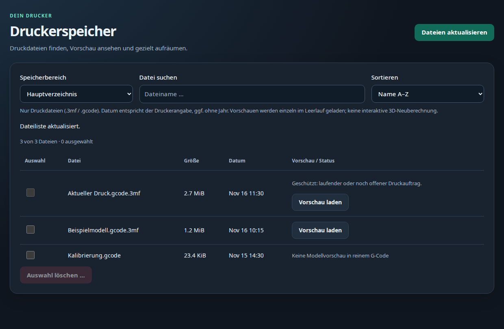

Der eigene Reiter liest Druckdateien direkt über FTPS vom Drucker. Die Bereiche Hauptverzeichnis, Druckcache und Modelle werden einzeln abgefragt; nicht vorhandene oder nicht erreichbare Bereiche zeigen einen Fehler statt einer scheinbar leeren Speicherkarte. Unterstützt werden reguläre `.3mf`- und `.gcode`-Dateien. Verzeichnisse, Links und Systemdateien werden nicht zum Löschen angeboten.

- Suche nach Dateiname; Sortierung nach Name, Größe oder der Drucker-Datumsangabe. Die FTP-Angabe kann ohne Jahr sein; die Datumssortierung verwendet in diesem Fall eine Jahresannahme. Es wird keine exakte Aufnahmezeit behauptet.
- Bereits im App-Cache vorhandene Bilder erscheinen als kleine Miniatur direkt neben dem Vorschau-Button. „Vorschau öffnen“ vergrößert sie. Beim erneuten Aufruf wird die 3MF nicht erneut vom Drucker geladen.
- „Vorschau laden“ liest bei bestätigtem Leerlauf einzeln ein gespeichertes PNG-/JPEG-Modellbild aus dem Druckarchiv. Übliche Bambu-Plattenbilder werden berücksichtigt. Das ist keine drehbare 3D-Neuberechnung. Bei reinem G-Code, fehlendem Bild oder zu langsamer Übertragung wird der Grund angezeigt. Das Archiv wird fortlaufend nur bis zum ersten unterstützten Bild gelesen; nach erfolgreicher Prüfsummenprüfung endet die Übertragung vor dem großen G-Code. Die Gesamtgröße der 3MF ist dafür nicht mehr auf 24 MiB beschränkt. Gelesen werden höchstens 8 MiB Archivanfang, das Bild darf höchstens 2 MiB groß sein. Liegt es weiter hinten, wird die Grenze verständlich gemeldet. Auch ZIP-Datenbeschreibungen und ZIP64-Größen werden berücksichtigt. Der Drucker muss dafür keine Teilabrufe unterstützen.
- Eine oder mehrere Dateien auswählen, „Auswahl löschen …“ öffnen, die konkreten Dateinamen prüfen und die endgültige Löschung ausdrücklich bestätigen. Keine automatische Speicherbereinigung. Maximal 50 Dateien je Auswahl; ein Zeitlimit kann einen großen Stapel vorzeitig stoppen.
- Vor der ersten Löschung wird die Auswahl erneut geprüft. Vor jeder Datei müssen Druckerleerlauf und Auftragszustand weiterhin passen; Dateigröße und Datum werden erneut verglichen. Laufende oder offene Aufträge schützen ihre Dateien. Bei Teilfehlern bleiben bereits erfolgte Löschungen bestehen; die Liste wird neu gelesen. Nicht ungeprüft wiederholen.

### App-Bildcache und Drucker-Cache unterscheiden

Der App-Bildcache speichert ausschließlich extrahierte Vorschaubilder auf dem NAS, nicht die vollständigen Druckarchive. Er ist vom Inventar und Journal getrennt. Gültigkeit: 30 Tage; Begrenzung auf 200 Bilder beziehungsweise 64 MiB Bilddaten. Bei Bedarf werden ältere, zuletzt nicht verwendete Bilder verdrängt. Pfad, Dateigröße, Drucker-Datumsangabe und Druckeridentität bilden den Cache-Schlüssel. Änderungen dieser Angaben verhindern die Wiederverwendung alter Bilder; bei externen Änderungen mit identischer Größe und identischer Datumsangabe kann ein manuelles Leeren nötig sein.

„Fehlende Bilder im sichtbaren Bereich automatisch laden“ ist standardmäßig aus. Bei Aktivierung werden sichtbare 3MF-Zeilen einzeln nacheinander im Leerlauf vorbereitet; es öffnet sich kein Dialog. Bei fehlendem Leerlauf oder einem Verbindungsproblem pausiert die Automatik. Bereits gespeicherte Bilder benötigen keinen erneuten Druckertransfer und können auch während eines Drucks geöffnet werden. Die Dateiliste selbst wird weiterhin vom Drucker gelesen. Das ist keine Offline-Dateibibliothek.

„App-Bildcache leeren …“ entfernt nach Bestätigung nur diese entbehrlichen Bilder. Sie können später neu geladen werden. Druckerdateien, Bestände und Journal werden dadurch nicht verändert. Die Bilddatei-Datenbank liegt privat neben der Anwendungsdatenbank und muss für einen Restore des Inventars nicht wiederhergestellt werden.

Der Bereich **Druckcache (`/cache`) auf dem Drucker** enthält dagegen unter anderem übertragene Druckdateien. Alte Dateien abgeschlossener Drucke können gezielt entfernt werden, wenn sie nicht mehr zum erneuten Drucken gebraucht werden oder die ursprüngliche Datei anderweitig gesichert ist. Nicht den kompletten Ordner blind leeren und keine Systemdateien löschen. Die GUI erlaubt nur ausgewählte reguläre Druckdateien, schützt laufende/offene Aufträge und verlangt Leerlauf. Eine automatische Bereinigung dieses Druckerordners erfolgt nicht.

Buchungsjournal, Filamentbestände und abgeschlossene Aufträge bleiben beim Löschen einer Druckerdatei erhalten. Eine Datei erneut drucken zu können erfordert danach die ursprüngliche Datei auf deinem Rechner oder eine eigene Sicherung. Dateien werden nicht automatisch vor dem Löschen archiviert. Der Reiter bietet keine Uploadfunktion und keine freie Navigation in beliebige Drucker-Systemverzeichnisse. Ein ausdrücklich bestätigter Druckstart aus einer geslicten 3MF ist über „Details & Drucken …“ möglich.

## Kamera und Licht

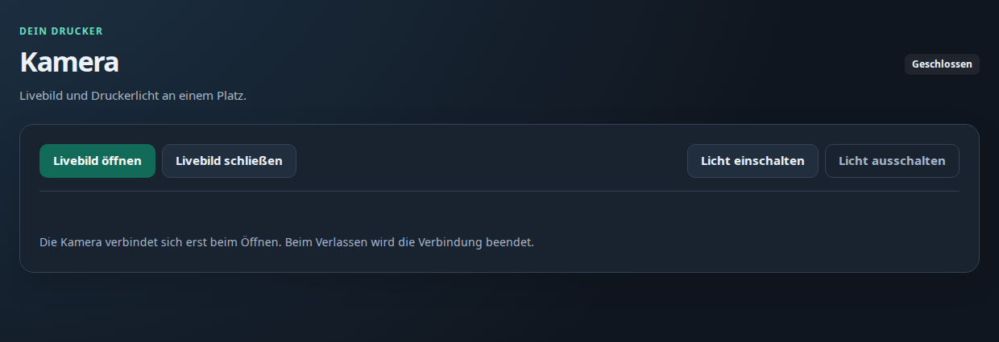

„Livebild öffnen“ verbindet die Kamera bei Bedarf. „Livebild schließen“, Seitenwechsel oder Ausblenden beendet die Anzeige; bei Bedarf wieder öffnen. Die Lichtschalter stehen oberhalb der Bildfläche und funktionieren auch ohne geöffnetes Livebild.

Eine Lichtaktion ist erst nach einer **neuen passenden Druckerrückmeldung** erfolgreich. Das bestätigt den gemeldeten Gerätezustand, ist aber keine optische Lampenmessung. Das Licht ist unabhängig von der Tapo-Steckdose.

Unterstützt wird der implementierte A1/P1-LAN-Kamerastream; X1/RTSP ist nicht integriert. Nur eine Anzeige kann gleichzeitig laufen. Bei „Kamera wird bereits angezeigt“ die andere Ansicht schließen. Kameraausfälle stoppen keine Verbrauchsbuchung.

## Steckdose und Energie

Die Tapo P110 benötigt eine private Konfiguration und Erreichbarkeit aus dem Container. Die Seite zeigt Leistung in Watt, Tages-/Monatsenergie in kWh und heutige Laufzeit. Diese Messwerte werden nicht einzelnen Druckaufträgen zugerechnet. Fehlende Werte stehen als „—“; nach Fehlern werden alte Daten nicht als neu ausgegeben.

„Status aktualisieren“ fragt einmalig ab. „Live-Status aktivieren“ erlaubt Abfragen alle 5, 10 oder 30 Sekunden; bei unsichtbarem Reiter pausieren sie. Einschalten ist manuell möglich.

Beim Ausschalten wird expliziter Druckerleerlauf geprüft. Ein höchstens 30 Sekunden alter bestätigter Zustand IDLE/FINISH kann verwendet werden; ältere Zustände werden neu angefordert. Direkt vor dem Schalten prüft der getrennte Tapo-Hilfsprozess erneut Verbindung, Aktualität und Leerlauf. Laufender oder pausierter Druck, unbekannter Zustand, Offline und fehlende Antwort sperren das Ausschalten. **Eingeschaltetes Druckerlicht blockiert nicht.** Ein ausgeschalteter Drucker kann selbst keinen frischen Leerlauf bestätigen.

Die Konfiguration nutzt `TAPO_HOST`, `TAPO_USERNAME`, `TAPO_PASSWORD` oder die entsprechenden `_FILE`-Variablen mit geschützten, im Container lesbaren Dateien. Keine Gerätezugänge in Screenshots oder Exporte für GitHub aufnehmen. Der Hilfsprozess isoliert Fehler der nativen Gerätebibliothek von der Webanwendung.

## Automatisch nach dem Druck ausschalten

In der Druckübersicht „Nach diesem Druck ausschalten“ für den **aktuellen laufenden Auftrag** aktivieren, Verzögerung wählen und speichern. Standard: zwei Minuten; wahlweise eine oder drei. Die Option ist standardmäßig aus und gilt nicht dauerhaft für folgende Drucke.

1. Normalen Druckabschluss abwarten.
2. Verbrauchsbuchung und gegebenenfalls Zuordnungsprüfung vollständig abschließen.
3. Gewählte Verzögerung abwarten.
4. Neue explizite Leerlaufmeldung anfordern.
5. Auftrag, aktivierte Option und Druckerzustand unmittelbar vor dem Tapo-Schalten erneut prüfen.

Abbruch, neuer Druck, ungeklärte Buchung oder fehlender Leerlauf verhindern das Schalten. Ein unklarer Ausschaltversuch wird nicht automatisch wiederholt. Nach Neustart während eines Schaltversuchs bleibt die Automatik aus. Sie schaltet den Drucker nicht selbst ein.

Die Verzögerung ist **keine temperaturgeführte Abkühlprüfung**. Die Funktion prüft keine Düsen- oder Betttemperatur. Native Inventarexporte aktivieren beim Wiederherstellen keine Abschaltautomatik; vollständige SQLite-Sicherungen enthalten dagegen den gespeicherten Zustand. Ein echter automatischer Abschaltzyklus dieser neuen Funktion ist bisher noch nicht hardwarebestätigt.

## Einstellungen und Flusskontrolle

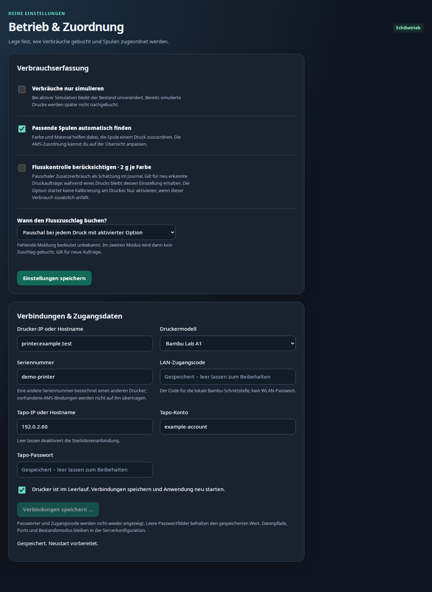

### Simulation

„Verbräuche nur simulieren“ schreibt keine Druckverbräuche in den Bestand. Frühere Simulationen werden nach Deaktivierung nicht nachgebucht. Der Modus wird je Auftrag gespeichert. Er verhindert keine ausdrücklich ausgelösten Geräteaktionen oder Inventarkorrekturen.

### Automatischer Abgleich

„Passende Spulen automatisch finden“ ergänzt fehlende Slicer→AMS-Zuordnungen anhand der gespeicherten Materialfamilie und exakten Farbe. Es gibt keine Farbnähe-Toleranz und keine automatische Erkennung der physischen Rollenidentität. Die externe Spule muss ausdrücklich zugeordnet werden. Die App-Zuordnung bleibt der bevorzugte Rollenwechselablauf.

### Flusskontrolle: 2 g je Farbe

„Flusskontrolle berücksichtigen · 2 g je Farbe“ ist ein **optionaler Verbrauchszuschlag** und startet keine Kalibrierung. Standardmäßig aus. Die Einstellung wird beim Erkennen eines neuen Druckauftrags festgeschrieben; spätere Änderungen gelten erst für weitere Aufträge.

Technisch bedeutet „je Farbe“: **je Slicer-Filamentposition mit positivem geplantem Verbrauch** einmalig 2 g zusätzlich. Zwei gleichfarbige, separat angelegte Slicer-Positionen können daher jeweils einen Zuschlag erhalten. Die App behauptet keine gemessene Kalibrierungsmenge. Bei einer Aufteilung auf mehrere Rollen wird der Zuschlag mit der Gesamtmenge verteilt und nicht pro Reservespule erneut addiert.

Beispiel: 10 g Rot + 20 g Gold laut Slicer → bei aktivierter Option 12 g Rot + 22 g Gold. Der Journalhinweis nennt den pauschalen Zusatzverbrauch als Schätzung. Der Buchungsplan wird eingefroren, sodass Wiederaufnahme und Wiederholung keinen weiteren Zuschlag erzeugen.

Bei Abbruch wird der Grundverbrauch weiterhin nach Fortschritt geschätzt. Jede dabei positive Filamentposition erhält den vollen 2-g-Zuschlag; es wird keine genaue Verwendung einzelner Farben bis zum Abbruch gemessen. Bei null geschätztem Verbrauch entfällt auch der Zuschlag. Deshalb vor allem bei frühen Abbrüchen und Mehrmaterial das Ergebnis prüfen.

Die Option ausschalten, wenn keine Flusskalibrierung läuft oder deren Verbrauch bereits in den verwendeten Grammwerten enthalten ist. Eigenständige Kalibrierungsdrucke können selbst als Auftrag erfasst werden; einen zusätzlichen Zuschlag dafür bewusst prüfen.

### Automatische Erkennung der Kalibrierung

Die dokumentierte Startanfrage kennt `flow_cali`. Das ist keine hier nachgewiesene, dauerhaft verfügbare Statusbestätigung für einen aus Bambu Studio gestarteten A1-Auftrag. Bei einem Start aus unserer Oberfläche wird die gewählte Option dem erkannten Auftrag zugeordnet; ein explizites `flow_cali`-Feld in einer Auftragsrückmeldung wird ebenfalls berücksichtigt. „Angefordert“ bedeutet noch nicht „durchgeführt“. Bambu Studio ordnet außerdem die Statusphase 8 der laufenden dynamischen Flusskalibrierung zu. Wenn der A1 diese Phase während der Beobachtung meldet, wird dies als positiver Nachweis einer laufenden Kalibrierung gespeichert. Das Ausbleiben der Meldung beweist keine deaktivierte Kalibrierung: Die App könnte zu spät verbunden gewesen sein oder die Phase nicht erhalten haben. Die Anwendung speichert eine frisch gemeldete Phase 8 jetzt dauerhaft beim aktiven Auftrag. In den Einstellungen lässt sich der 2-g-Zuschlag auf solche positiv bestätigten Fälle beschränken. Ohne Meldung bleibt die Durchführung unbekannt; in diesem Modus gibt es dann keinen Zuschlag. Ein eingestelltes K-Profil belegt ebenfalls nicht, dass in diesem Druck neu kalibriert wurde. Quelle zur Phase: [Bambu Studio – Statusphasen](https://github.com/bambulab/BambuStudio/blob/master/src/slic3r/GUI/DeviceManager.cpp). Startoption und beobachtete Durchführung werden getrennt dargestellt. Ein gesetztes K-Profil ersetzt keine Durchführungsmeldung. Quelle: [OpenBambuAPI – project_file](https://github.com/Doridian/OpenBambuAPI/blob/main/mqtt.md#printproject_file).

## Fehlersuche und Grenzen

| Beobachtung | Prüfung |
|---|---|
| AMS-Schreibbefehl abgelehnt | Nach Druckende LAN-only und Entwicklermodus, aktuellen Code und Verbindung prüfen. Modus nicht während eines Drucks wechseln. |
| Kein geeignetes AMS-Profil | Materialtyp zuerst über Bambu Studio setzen; keine Kennungen oder Temperaturen erraten. |
| Rolle gewählt, Drucker unverändert | Auswahl ist nur Entwurf; Vorschau öffnen und bestätigen. Fehlermeldung beziehungsweise unklare Rückmeldung prüfen. |
| Schacht während Druck gesperrt | Aktiver oder angeforderter Schacht, unbekannte Slotlage oder veralteter Status. |
| Archivierte Rolle nicht endgültig löschbar | Aktuelle Zuordnung lösen, offene Aufträge klären und „Aus Inventar entfernen“ verwenden. |
| Ausschalten gesperrt | Eindeutiges IDLE/FINISH und aktuelle Verbindung erforderlich; Lichtzustand ist kein Hindernis. |
| Sitzung abgelaufen | Seite neu öffnen und Eingabe wiederholen; abgelehntes Formular wurde nicht gespeichert. |
| Produktvorlage nicht verfügbar | Katalogverbindung prüfen oder Produkt manuell anlegen. |

Die Anwendung ist auf einen Drucker und dessen AMS Lite zugeschnitten. Eine beliebige Mehrdruckersteuerung, automatisches physisches Rollenladen, slicerbezogene Profilkalibrierung, temperaturgeführtes Ausschalten sind hier nicht implementiert. Zusätzliche lokale Firmwarebefehle durch Developer Mode sind keine automatisch bereits integrierten App-Funktionen.

Private `.env`, Zugänge, Schlüssel, Datenbanken, Logs, Inventarexporte und Backups außerhalb von Git aufbewahren. Vollständige Exporte können eigene Notizen und historische Datensätze enthalten. Installation und Wiederherstellung: [Betrieb](plus-operations.md). Entwicklungs- und Hardwareprüfung: [Deployment und Prüfung](../DEPLOYMENT.md).

## Helles und dunkles Design

Oben rechts lässt sich mit „Helles Design“ beziehungsweise „Dunkles Design“ die Darstellung umschalten. Die Auswahl gilt für alle Bereiche und wird in diesem Browser gespeichert. Andere Geräte können unabhängig ein anderes Design verwenden. Falls der Browser das Speichern blockiert, funktioniert der Wechsel auf der aktuellen Seite weiterhin. Ohne gespeicherte Auswahl bleibt das bisherige dunkle Design aktiv. Filamentfarben werden durch den Designwechsel nicht verändert.

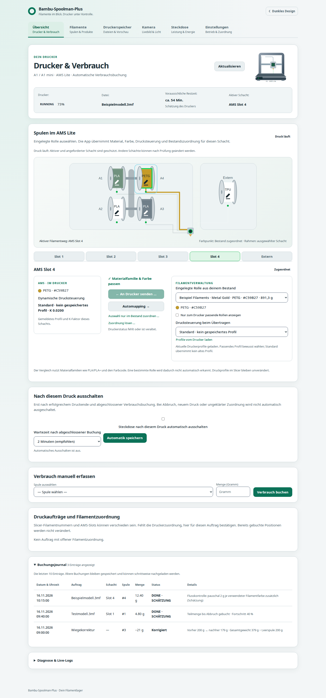

## Dateidetails, Druckstart und Bereinigung

### Datei ansehen und erneut drucken

1. Unter **Druckerspeicher** bei einer geslicten 3MF **Details & Drucken …** wählen. Beim ersten Aufruf wird das Archiv im bestätigten Leerlauf im Hintergrund gelesen. Der Fortschritt erscheint im Dialog. Die vollständige Datei bleibt nicht im App-Cache.
2. Die tatsächlich geslicte Druckplatte wählen. Eine Datei kann nur Platte 3 enthalten; die App ersetzt deren Nummer nicht durch 1. Das Bild gehört zur ausgewählten Platte, soweit es im Archiv vorhanden ist. Dazu erscheinen Modell, Düse, geschätzte Dauer, Filamentbedarf, Objekte und Slicerhinweise.
3. Jede verwendete Slicer-Filamentposition einem AMS-Schacht zuordnen. Eine eindeutig passende Material-/Farbkombination wird vorgeschlagen. Der Schacht braucht eine gepflegte Bestandsrolle. Eine einzelne externe Rolle ist ebenfalls möglich; gemischter AMS-/Extern-Betrieb wird in diesem Dialog nicht angeboten.
4. Material-/Farbabweichungen gegebenenfalls bewusst erlauben. Die Auswahl ändert keine AMS-Filamentstammdaten. Für einen regulären Rollenwechsel vorher den AMS-Bereich verwenden.
5. Druckbett-Nivellierung, dynamische Flusskontrolle, Vibrationskompensation und Zeitraffer bewusst wählen. Standard ist nur Nivellierung. Der Verbrauchszuschlag ist davon eine getrennte Einstellung.
6. **Druckstart prüfen …** wählen. Die Zusammenfassung lesen, die freie und vorbereitete Druckplatte bestätigen und **Jetzt drucken** betätigen.

Die Bestätigung gilt einmalig und zwei Minuten. Geänderte Auswahl macht sie ungültig. Direkt vor dem Befehl werden Datei, frischer Leerlauf, Düse, Material/Farbe und Bestandsbindungen erneut geprüft. Ein laufender oder ungeklärter Auftrag sperrt den Start. Bei unklarer Rückmeldung den realen Druckerstatus prüfen; die App wiederholt den Start nicht automatisch. Ein vorheriger Versuch sperrt weitere Versuche für zwei Minuten. Erfolg wird erst bei einer neuen passenden PREPARE-/RUNNING-Rückmeldung angezeigt.

Die Modellprüfung nutzt `BAMBU_MODEL` (Standard `Bambu Lab A1`; für A1 mini entsprechend setzen) und die vom Drucker gemeldete Düsengröße. Nicht passende oder unbekannte Daten sperren den Start. Unterstützung ist auf geslicte 3MF-Dateien begrenzt; reine G-Code-Dateien bieten Historie, aber keinen Startdialog mit geprüfter Filamentzuordnung. Es wird nicht neu geslicet.

Dateidetails unterstützen Archive bis 128 MiB und höchstens vier Minuten Transferzeit; XML-/JSON-Konfigurationen sind einzeln auf 2 MiB begrenzt. Bei Druckbeginn während des Lesens wird der Transfer bei der nächsten Leerlaufprüfung gestoppt. Metadaten und kleine Plattenbilder werden getrennt vom Inventar für bis zu 30 Tage zwischengespeichert, höchstens 100 Einträge beziehungsweise 16 MiB. Der Bildcache-Schalter leert weiterhin nur die normalen Modellminiaturen.

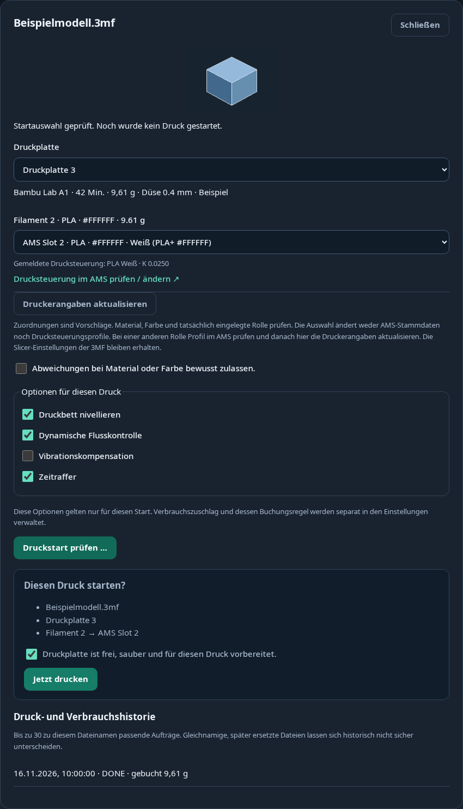

### Historie und gezielte Bereinigung

Der Dateidialog zeigt bis zu 30 passende Aufträge aus den letzten 1.000 Druckaufträgen, mit Zeitpunkt, Status, Abbruchhinweis und gebuchtem Verbrauch. Die Verbindung erfolgt über den normalisierten Dateinamen. Gleichnamig ersetzte Dateien können historisch nicht eindeutig unterschieden werden. Das Journal bleibt die verbindliche Buchungshistorie.

Über **Ansicht** zwischen Liste und Kacheln wechseln; der Browser merkt sich die Wahl. Suche, Mindestgröße und ungefähres Dateialter lassen sich kombinieren. Fehlt dem Druckerdatum das Jahr, wird es geschätzt. Die Anzeige nennt die Gesamtgröße im Filter und die Summe der ausgewählten Dateien. **Gefilterte Dateien auswählen** lässt geschützte Dateien aus. Erst die anschließende Löschübersicht mit eigener Bestätigung entfernt genau die geprüfte Auswahl. Es gibt keine automatische Bereinigung.

### Flusskontrolle: Nachweis statt Vermutung

Im Journal werden positive Durchführungsmeldung, explizite Startanforderung und unbekannter Zustand unterschieden. Fehlende Phase 8 beweist keine ausgeschaltete Kalibrierung. Ältere Aufträge werden nicht rückwirkend als erkannt markiert und nicht neu gebucht.

Unter Einstellungen gilt für neue Aufträge wahlweise die bisherige **Pauschale** oder **nur bei gemeldeter Flusskontrolle (Stufe 8)**. Auch im zweiten Modus bleiben die 2 g je positiver verwendeter Filamentposition eine Schätzung, keine vom Drucker gemessene Grammmenge. Bei ausgeschaltetem Verbrauchszuschlag wird weiterhin nichts zusätzlich gebucht. Bereits laufende Aufträge behalten ihre festgeschriebene Regel.

Beim MQTT-Wiederanlauf werden leere AMS-Platzhaltermeldungen in der ersten Minute nicht als Rollenentnahme gewertet. Vollständige Angaben können sofort angezeigt werden; bleibt ein Schacht nach der Startphase tatsächlich leer, wird dessen Zuordnung bei einer folgenden Rückmeldung weiterhin gelöst.

## Verbindungseinstellungen im lokalen Betrieb

Unter **Einstellungen → Verbindungen & Zugangsdaten** lassen sich Drucker-IP beziehungsweise Hostname, LAN-Zugangscode, Seriennummer, Modell sowie Tapo-Adresse, Konto und Passwort pflegen. Dafür wird keine zusätzliche Anmeldung eingeführt. Eine bereits über die Serverkonfiguration aktivierte optionale Web-Anmeldung bleibt wirksam. Gemeint ist der achtstellige **LAN-Zugangscode** der Bambu-Schnittstelle; WLAN-SSID und WLAN-Passwort werden weiterhin am Drucker eingerichtet.

Passwortfelder bleiben leer. Wer nur eine Adresse ändern möchte, lässt vorhandene Passwörter unverändert leer. Die Anwendung übernimmt dann deren bisherige Werte. Eine leere Tapo-Adresse deaktiviert die Steckdosenanbindung. Eine geänderte Seriennummer bezeichnet einen anderen Drucker: Alte AMS-Bindungen werden nicht still auf ihn übertragen.

Nach der ausdrücklichen Leerlaufbestätigung wird die Konfiguration atomar in `device-settings.json` im persistenten Datenverzeichnis gespeichert, mit Dateimodus 0600. Der Docker-Dienst startet anschließend kontrolliert neu. Läuft ein Druck, eine Abrechnung, eine Kameraübertragung oder ein Dateizugriff, wird die Änderung abgelehnt beziehungsweise der Neustart bis zum Leerlauf zurückgestellt. Zugangsdaten erscheinen weder im normalen Filamentexport noch in Protokollen oder vorausgefüllten Passwortfeldern. Die Datei bleibt lokal; sie ist nicht verschlüsselt. Vollständige private Serversicherungen enthalten sie und sind entsprechend privat aufzubewahren.

Gespeicherte Werte haben beim Start Vorrang vor den entsprechenden `.env`-Werten und alten Secret-Dateien. Für die erstmalige Installation gelten weiterhin die benötigten Basiswerte in der Serverkonfiguration. Ports, Datenpfade und Bestandsmodus bleiben dort; die GUI ändert keine Docker-Netzwerke und führt keinen Backendwechsel aus. Für einen Rückfall auf `.env`: Dienst stoppen, private Konfiguration sichern, deren Datei entfernen und den Dienst wieder starten.

### Schnellere Vorbereitung großer Druckdateien

Der Details-Dialog zeigt Optionen und Historie sofort. Soweit frühe Archiveinträge bereits Druckplatte und Filamente liefern, erscheinen diese während des Downloads als **vorläufige** Angaben. Eingestellte Optionen und gewählte Rollen bleiben beim Abschluss der Prüfung erhalten. Der Start bleibt gesperrt, bis die vollständigen Druckdaten geprüft sind; vorläufige Werte gelangen nicht in die Verbrauchsbuchung.

Beim Referenz-A1 liegen die verbindlichen Druckdaten am Archivende, und dessen FTPS-Server unterstützt keine REST-Teilabrufe. Deshalb bleibt beim ersten, noch nicht zwischengespeicherten Aufruf die vollständige Übertragung erforderlich. Es wird kein 3D-Modell neu generiert. Erneute Aufrufe verwenden den vorhandenen Metadatencache. Bei anderen Archivlayouts ohne früh lesbare Angaben bleiben zumindest die Optionen sofort bedienbar.

### Dateien umbenennen

Im Druckerspeicher **Umbenennen …** wählen, den Namen ohne Dateiendung eingeben und bestätigen. Die bisherige Endung bleibt erhalten. Dateien werden innerhalb ihres bisherigen Verzeichnisses umbenannt; vorhandene Zielnamen und Dateien laufender/offener Aufträge werden abgelehnt. Die App prüft Datei und Leerlauf erneut und überschreibt keine vorhandenen Dateien.

Bereits geladene Vorschaubilder und Metadaten werden für den neuen Namen übernommen. Die Historie berücksichtigt bekannte frühere Dateinamen; vorhandene Journalzeilen werden nicht umgeschrieben. Wie bisher können später erneut verwendete identische Dateinamen nicht zuverlässig als dieselbe physische Datei erkannt werden.

### Dateiprüfung abbrechen und anderes Modell öffnen

**Schließen** oder **Escape** beendet einen noch laufenden Metadaten-Download. Auch beim Wegnavigieren von der Seite wird der Abbruch angefordert. Der Server schließt die Datenverbindung, verwirft die unvollständige temporäre Datei und gibt den Dateizugriff wieder frei. Danach lassen sich die Modellliste und ein anderer Druckdialog wieder öffnen. Antworten eines inzwischen geschlossenen Dialogs ersetzen keine neuere Auswahl. Wird dieselbe Prüfung in einem zweiten Fenster noch benötigt, läuft sie für dieses Fenster weiter. Bereits vollständig geprüfte Cacheeinträge bleiben erhalten.

### Profil und K-Faktor bei einer anderen Filamentzuordnung

Im Druckdialog wird eine Slicer-Filamentposition einem vorhandenen AMS-Schacht zugeordnet. Diese Auswahl schreibt keine neue Farbe, keinen neuen Filamenttyp und keinen K-Faktor in den Schacht. Sie ersetzt auch kein Slicerprofil in der fertig geslicten 3MF.

Unter jeder Auswahl werden das **gemeldete Schachtprofil** und der **gemeldete K-Faktor** angezeigt, soweit der Drucker diese Daten geliefert hat. „Standard“ bedeutet kein ausgewähltes gespeichertes Profil, nicht zwingend K = 0. Fehlende Daten werden als unbekannt dargestellt.

Über **Drucksteuerung im AMS prüfen / ändern** öffnet sich die vorhandene AMS-Verwaltung direkt beim gewählten Schacht. Dort das zur eingelegten Rolle passende Profil bewusst wählen und die Änderung bestätigen. Anschließend im Druckdialog **Druckerangaben aktualisieren** betätigen. Die Auswahl bleibt erhalten; eine alte Startprüfung wird verworfen. Profil-/K-Änderungen zwischen Prüfung und Start machen eine erneute Prüfung erforderlich.

Eine angeforderte dynamische Flusskontrolle bleibt eine separate Druckoption. Sie ist kein automatischer Austausch aller Slicerparameter. Bei einem anderen Material oder wesentlich anderem Filamentprofil gegebenenfalls mit passendem Profil neu slicen.

### Modellplatte und Druckbettoberfläche unterscheiden

„Modellplatte 1/2/…“ bezeichnet den Bereich aus dem Bambu-Studio-Projekt. Ein gespeicherter eigener Plattenname erscheint zusätzlich. Die Nummer wird weiterhin unverändert zur Auswahl des passenden geslicten G-Codes verwendet.

Separat zeigt der Dialog „Druckbettoberfläche laut Datei“, etwa **Textured PEI Plate**, **Cool Plate**, **Smooth PEI Plate / High Temp Plate** oder **Bambu Cool Plate SuperTack**. Grundlage sind die platteneigene `bed_type`-Einstellung aus `Metadata/model_settings.config` und ersatzweise `curr_bed_type` aus `Metadata/project_settings.config`. Plattenbezogene Angaben haben Vorrang. Fehlende Angaben werden als unbekannt angezeigt; eine Default-Einstellung wird nicht als konkrete Oberfläche ausgegeben.

Das hilft auch bei älteren Dateien zu erkennen, für welche Oberfläche sie vorbereitet wurden. Es bestätigt weder die tatsächlich aufgelegte Platte noch die Oberfläche eines früheren Drucks, wenn die Datei zwischenzeitlich ersetzt wurde. Die Anzeige ändert keine Temperaturen und ersetzt kein erneutes Slicen für eine andere Oberfläche. Vor dem Start Datei und aufgelegte Platte vergleichen. Die Information erscheint ebenfalls in der Startbestätigung.

Die Zuordnung und Bezeichnungen sind im offiziellen [Bambu-Studio-3MF-Leser](https://github.com/bambulab/BambuStudio/blob/master/src/libslic3r/Format/bbs_3mf.cpp) und in dessen [Druckkonfiguration](https://github.com/bambulab/BambuStudio/blob/master/src/libslic3r/PrintConfig.cpp) nachvollziehbar. Bereits gecachte Dateidetails werden nach dieser Erweiterung einmal vollständig neu eingelesen; Vorschaubilder und Filamentdaten bleiben erhalten.

### Druckkosten: Rollenpreis und Stromtarif

Unter **Filamente → Physische Spulen → Bearbeiten** kann für jede Rolle der tatsächliche **Kaufpreis in Euro** hinterlegt werden. Dazu gehört die **Filamentmenge, auf die sich dieser Preis bezieht**, beispielsweise 19,99 € für 1.000 g. Leer lassen verwendet das Nenngewicht des Filamentprodukts. Das aktuelle Restgewicht und das ursprünglich eingetragene Startgewicht werden dafür nicht verwendet, weil eine Rolle beim Erfassen schon angebrochen sein kann. Ohne bekannten Preis oder bekannte Kaufmenge bleiben die Materialkosten unbekannt. Preis 0 bedeutet ausdrücklich kostenlos. Vorhandene Preise anderer Währungen werden nicht automatisch umgerechnet.

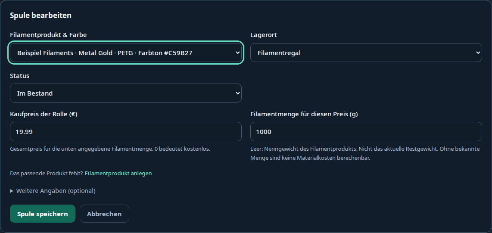

Unter **Einstellungen → Druckkosten** wird der vollständige Arbeitspreis des Stromtarifs in **€/kWh** eingetragen, beispielsweise 0,35. Eine leere Angabe bedeutet unbekannt; 0 bedeutet kostenlos. Diese Einstellung ist vom Betriebsmodus getrennt und verändert keine Zuordnungs- oder Buchungsoptionen. Der Tarif wird beim Erkennen eines neuen Druckauftrags eingefroren. Eine spätere Tarifänderung gilt für nachfolgende Aufträge.

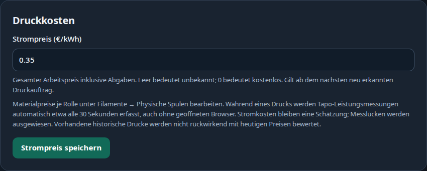

Die Startseite zeigt einen einklappbaren Bereich **Druckkosten** mit den letzten zehn Druckaufträgen, Datum, Status, Materialkosten, Stromkosten, erfasster Energie und Messabdeckung. Beim Öffnen oder über „Kosten aktualisieren“ wird der aktuelle Stand geladen. Auch die Dateihistorie im Druckerspeicher zeigt den Kostenstatus.

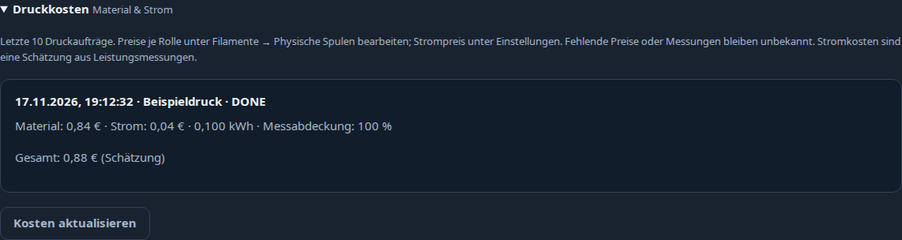

Materialkosten ergeben sich aus der **gebuchten** Filamentmenge je Rolle × Kaufpreis / Preis-Bezugsmenge. Ein tatsächlich gebuchter Flusskontrollzuschlag zählt mit; bei einem abgebrochenen Druck gilt die gebuchte Teilmenge. Der Rollenpreis wird beim Buchen als Snapshot gespeichert. Wiederholen der Buchung belastet weder Bestand noch Kosten doppelt. Nachträgliches Ändern eines Rollenpreises berechnet abgeschlossene Buchungen nicht neu. Manuelle Bestandskorrekturen sind keine Druckverbrauchskosten.

Die Stromerfassung arbeitet ohne geöffneten Browser: Bei aktiven Druckaufträgen wird die Tapo-Leistung etwa alle 30 Sekunden gelesen. Aus den Messpunkten wird der Energiebedarf geschätzt und mit dem eingefrorenen Tarif multipliziert. Startvorbereitung und Pausen gehören zur erfassten Auftragszeit, die Wartezeit nach dem Druckende nicht. Kurz fehlende Randabschnitte bis 45 Sekunden verwenden den benachbarten Leistungswert; lange Messlücken werden nicht aufgefüllt. Fehlender aktueller Druckerstatus, Tapo-Ausfälle oder ein Neustart können die Messabdeckung verringern. Dies ist eine **Schätzung aus Leistungsmessungen**, keine separate geeichte Energiemessung je Auftrag.

Nur wenn der Auftrag vollständig gebucht ist, alle Rollenpreise vorliegen, ein Tarif bekannt ist und die Auftragszeit vollständig abgedeckt wurde, erscheint eine Gesamtsumme als Schätzung. Sonst steht „Unvollständig“; vorhandene Teilbeträge und die Messabdeckung bleiben sichtbar. Material- und Stromkomponente werden jeweils auf Cent gerundet; die Gesamtsumme addiert diese angezeigten Komponenten. Abschreibungen, Maschinenverschleiß, Arbeitszeit und Grundgebühren sind nicht enthalten.

Historische Drucke werden standardmäßig nicht rückwirkend bewertet. Eine ausdrücklich veranlasste Rückrechnung kann separate Referenzschätzungen ergänzen; ihre Annahmen werden ausgewiesen. Es erfolgt keine nachträgliche Belastung von Spulen. Kosten von laufenden Simulationen werden nicht als gebuchte Druckkosten dargestellt.

Im hellen Design behalten Tabellenaktionen und Sortierbuttons auch bei Hover und Tastaturbedienung kontrastreiche dunkle Schrift.

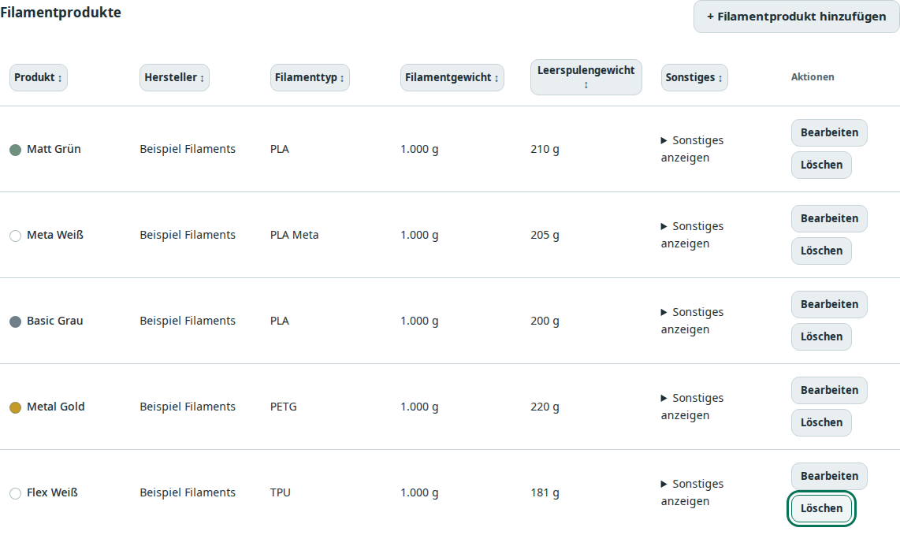

### Vereinfachte Filamentverwaltung und Standardgewicht

Die Spulenkarten sind die Hauptansicht. **Filamentprodukte** stehen darunter als eigener, standardmäßig eingeklappter Bereich mit separater Browserpräferenz. Beim Anlegen/Bearbeiten und nach dem Speichern öffnet er sich automatisch. Die zusätzliche tabellarische Spulenverwaltung, Hersteller und Lagerorte sind unter **Weitere Inventarverwaltung** zusammengefasst und zunächst eingeklappt. Der Klappzustand wird im Browser gespeichert. Karten-Bearbeitung, „Spule hinzufügen“, gespeicherte Datensätze und direkte Bereichslinks öffnen bei Bedarf den passenden Bereich. Die Tabellenansicht bleibt unter anderem zum Archivieren und Entfernen erhalten.

Beim Hinzufügen einer neuen Spule sind **1.000 g Startgewicht** vorausgefüllt. Der Wert kann geändert oder für einen unbekannten Bestand gelöscht werden. Diese Vorgabe setzt keine vorhandene Spule zurück und verändert keine Preis-Bezugsmenge.

### Historische Druckkosten als Referenz

Auf ausdrücklichen Wunsch können abgeschlossene Drucke nachträglich eine **historische Rückrechnung** erhalten. Diese wird getrennt von Verbrauchsbuchungen und gemessenen Stromdaten gespeichert. Die ursprünglichen Bestände, Verbrauchsmengen und Messwerte bleiben unverändert. Eine Wiederholung ergänzt keine doppelten Schätzungen und überschreibt keine vorhandene Rückrechnung. Simulationen und aktive Drucke sind ausgeschlossen.

Vorrang haben gebuchte Materialmengen und gespeicherte Preis-Snapshots. Fehlende Preise werden aus den heutigen Rollenpreisen ergänzt, ersatzweise aus Preisen desselben Produkts/Materials oder dem Median vorhandener Europreise. Ohne Vergleich gilt beispielhaft 20 €/kg; bei unbekannter Preis-Bezugsmenge werden 1.000 g angenommen. Ohne gebuchte Menge werden gespeicherte Slicerwerte verwendet; sonst ausdrücklich 2 g für einen Kalibrierungsauftrag oder 10 g als allgemeines Beispiel angesetzt. Das erzeugt ausschließlich Kostenreferenzen, keine Materialbuchung.

Für die Laufzeit werden gespeicherte Messzeiten, verfügbare Slicerzeiten oder eine plausible Zeitspanne zwischen Auftragserkennung und letzter Aktualisierung genutzt. Letztere kann Wartezeit auf Zuordnung/Buchung enthalten. Ohne plausible Angaben gelten beispielhaft fünf Minuten für Kalibrierung oder 30 Minuten für sonstige Drucke. Fehlende Messzeit wird mit **80 W mittlerer Leistung** geschätzt. Vorhandene Messenergie bleibt berücksichtigt. Der damalige Tarif hat Vorrang, sonst der heute gepflegte Tarif; ohne Angabe wird **0,35 €/kWh** angenommen.

Die Kostenübersicht kennzeichnet diese Einträge mit **Historische Rückrechnung**. Unter **Annahmen der Rückrechnung anzeigen** stehen die tatsächlich verwendeten Quellen und Ersatzwerte. Die Messabdeckung bleibt die echte Messabdeckung und wird durch eine Schätzung nicht auf 100 % gesetzt. Die Werte dienen als Anschauungsbeispiele; sie belegen keine tatsächlich historischen Kaufpreise oder Strommessungen.

### 3D-Druckwegvorschau

Unter **Druckerspeicher → Vorschau öffnen → 3D-Ansicht laden** lässt sich das Modell ohne Druckeinstellungen räumlich ansehen. Bei mehreren Modellplatten erscheint eine Auswahl. Alternativ steht derselbe Betrachter unter **Details & Drucken → 3D-Druckwegvorschau laden** bereit. Die normale Bildvorschau bleibt schnell und wird nicht automatisch durch einen vollständigen Download ersetzt. Ein Druck wird durch die Vorschau niemals gestartet.

- Ziehen mit Maus oder Finger dreht die Ansicht; Mausrad und zwei Finger zoomen. Im Detaildialog gibt es zusätzliche Zoom-/Resetbuttons.
- Bei fokussierter Grafik drehen die Pfeiltasten, Plus/Minus zoomen und Home setzt die Ansicht zurück.
- **Schräg**, **Oben** und **Vorne** stellen feste Ansichten ein. **Vollbild** vergrößert den Betrachter, sofern der Browser dies unterstützt; Escape beendet Vollbild.
- **Hintergrund → Automatisch** wählt anhand der Filamentfarben einen hellen, dunklen oder mittleren Hintergrund. **Hell** und **Dunkel** lassen sich manuell wählen; die Einstellung bleibt im Browser gespeichert und gilt in beiden Vorschau-Dialogen.
- **Bis Schicht** zeigt den Aufbau bis zur gewählten Höhe. Alle Höhen stammen aus den Druckbahnen; bei variabler Schichthöhe sind die Abstände entsprechend unterschiedlich.
- Schließen, Escape oder Wechsel der Modellplatte brechen laufende Hintergrundarbeit ab und geben die Dateizugriffe wieder frei. Im Detaildialog gibt es zusätzlich „Laden abbrechen“.

Der Betrachter zeigt **geslicte Druckbahnen**, kein CAD-Modell. Breite und Schichthöhe werden aus Slicerkommentaren übernommen oder angenähert und als beleuchtete Bahnen dargestellt. Unterstützt der Browser keine instanzierte WebGL-Darstellung, fällt die Ansicht auf Linien zurück. Ohne WebGL bleibt das gespeicherte Vorschaubild verfügbar. Einige geslicte 3MF enthalten keine Dreiecksgeometrie; ein allgemeiner 3MF-Modellviewer kann daraus keine echte Modelloberfläche laden.

G2/G3-Kreisbögen werden interpoliert, einschließlich I/J/K- und R-Angaben, Vollkreisen, Helices und G17/G18/G19-Ebenen. Markierte Start-/Reinigungsbahnen und Wipe-Tower werden ausgeblendet und beeinflussen nicht mehr die Zentrierung. Unmarkierte Hilfsbahnen können weiterhin sichtbar bleiben. Farben folgen auswertbaren Slicer-T-Befehlen; herstellerspezifische Werkzeugwechsel sind nicht garantiert richtig zugeordnet. Die Vorschau dient der Orientierung und verändert weder Materialzuordnung noch Slicerprofil.

Konturen werden nicht durch Auslassen jedes zweiten Segments vereinfacht. Zusammenhängende Bahnen gleicher Eigenschaften werden mit höchstens 0,035 mm zusätzlicher Konturabweichung vereinfacht; scharfe Ecken und getrennte Extrusionen bleiben erhalten. Grenzen: 1.250.000 dargestellte Segmente, 192 MiB entpackter G-Code, fünf Millionen Zeilen, 180 Sekunden Aufbereitung und 64 MiB unkomprimierte Geometriedaten. Bei Überschreitung erscheint eine Meldung; die Bildvorschau bleibt erhalten. Die Gesamtarchivgrenze für den Transfer beträgt 128 MiB. Sehr große Vorschauen können auf schwachen Grafikchips langsamer reagieren und beim ersten Aufbereiten länger benötigen. Bei mehr als 300.000 Segmenten vereinfacht der Renderer den Querschnitt der Bahnen, statt Druckwege wegzulassen. Große Geometrieantworten werden bei Browserunterstützung komprimiert übertragen. Bereits kompatible ältere Geometriecacheeinträge bleiben nutzbar; die Erweiterung erzwingt keinen erneuten Download aller Modelle.

Beim ersten Aufruf kann ein vollständiger Dateitransfer erforderlich sein; neue Transfers benötigen bestätigten Druckerleerlauf. Dateidetails und 3D-Aufbereitung verwenden einen bereits vollständig geladenen und geprüften Transfer gemeinsam, statt dasselbe Archiv direkt zweimal vom Drucker zu laden. Auch ein Plattenwechsel kann diese Kopie verwenden. Die temporäre Zwischenablage enthält höchstens zwei Archive mit zusammen 128 MiB und löscht jede Kopie automatisch spätestens nach fünf Minuten; erneute Nutzung verlängert die Frist nicht. Bei Neustart ist sie leer. „App-Vorschaudaten leeren“ entfernt auch diese Zwischenablage und bricht noch laufende Prüfungen ab. Es handelt sich um löschbare lokale Kopien, unabhängig von den Originaldateien auf dem Drucker.

Neue Downloads benötigen weiterhin die strenge frische Leerlaufbestätigung. Während eines bereits laufenden, reinen Lesevorgangs wird alle 15 Sekunden geprüft: Bei bestehender MQTT-Verbindung, ohne aktiven Auftrag und zuletzt explizit gemeldetem IDLE/FINISH darf diese Zustandsmeldung bis zu 90 Sekunden alt sein. Bestätigte Aktivität oder Offline stoppen sofort bei der nächsten Prüfung. Das längere Fenster gilt ausschließlich für das Fortsetzen von Dateilesevorgängen, nicht für neue Downloads, Druckstart, Löschen, Umbenennen oder Abschalten. Fehlt auch nach dieser Grenze eine Bestätigung, zeigt die App „Warte auf neue Leerlaufbestätigung“ und fragt einmal erneut an. Bestätigte Druckaktivität oder eine unterbrochene Verbindung stoppen sofort; ohne neue Bestätigung wird nach dem zweiten Versuch ebenfalls gestoppt. Die Fehlermeldungen unterscheiden diese Fälle. Eine fehlende Bestätigung bedeutet nicht automatisch, dass tatsächlich ein Druck läuft. Die Schalt- und Druckstartregeln werden dadurch nicht gelockert.

Die tatsächliche erste FTPS-Übertragungsrate hängt weiterhin von Drucker, Speicherkarte und Netzwerk ab. Die Optimierung vermeidet Wiederholungsübertragungen; sie verspricht keine bestimmte MB/s-Rate. Erfolgreiche Ergebnisse werden getrennt vom Inventar zwischengespeichert: höchstens 50 Modelle, 128 MiB komprimierte Daten und 30 Tage. Dateigröße/-datum, Drucker, Platte und Parser-Version gehören zur Cacheidentität. Ein Parserupdate bereitet alte Geometrie neu auf. **App-Vorschaudaten leeren** entfernt Bilder und 3D-Cache, keine Druckerdateien, Bestände oder Kosten. Originalarchive werden nicht dauerhaft im App-Cache gespeichert; die oben beschriebene kurzlebige Zwischenablage ist davon getrennt.

Anregungen zu Bedienung und Darstellung stammen aus [3MFConsortium/3mfViewer](https://github.com/3MFConsortium/3mfViewer), [Polar3D/gcode-viewer](https://github.com/Polar3D/gcode-viewer) und [AheadWind/gcode-viewer.github.io](https://github.com/AheadWind/gcode-viewer.github.io). Es wurde kein Quellcode dieser Projekte eingebunden. Parser und Renderer sind eigene, lokal ausgelieferte Komponenten ohne CDN oder externe Viewer-Dienste.

Messungen, bereits umgesetzte Beschleunigungen und die Abgrenzung zwischen Download, erster Aufbereitung und Cache stehen in [Ladezeit der Druckerspeichervorschau](performance.md).

### Passendes Plattenbild und erkennbare dunkle Modelle

Ein gespeichertes Druckarchiv kann eine Projektübersicht und Bilder mehrerer Modellplatten enthalten, obwohl nur Modellplatte 2 oder 3 tatsächlich geslict ist. Die Bildvorschau wählt deshalb das Bild zur enthaltenen G-Code-Platte. Eine Projektübersicht oder das Bild einer anderen Platte wird nicht als Ersatz für ein fehlendes geslictes Plattenbild angezeigt. Bei mehreren enthaltenen G-Code-Platten verwendet die schnelle Vorschau die erste ausführbare Platte im Archiv; neu eingelesene Dateidetails und der 3D-Dialog verwenden dieselbe Reihenfolge. Der Plattenwähler bietet weiterhin alle tatsächlich geslicten Platten an.

Die App liest dafür nur den nötigen Archivanfang bis zum ersten G-Code-Eintrag. Bereits vollständig geprüfte Plattenmetadaten können das passende Bild direkt liefern. Wenn vorhanden und innerhalb der Bildgrenzen, wird das größere Plattenbild bevorzugt. Fehlt ein eindeutiges Bild, erscheint eine Meldung anstelle einer fremden Projektansicht.

Alte Bildcacheeinträge werden durch eine neue Bildauswahl-Version ersetzt; die Bild-URLs sind ebenfalls versioniert. Ein Neuladen der Seite übernimmt die korrigierten Bilder. Der getrennte 3D-Geometrie- und Metadatencache bleibt nutzbar; ein Leeren aller App-Vorschaudaten ist dafür nicht nötig.

Dunkle Filamentfarben werden im 3D-Betrachter für sichtbare Formdetails aufgehellt und durch ergänzende Beleuchtung unterstützt. Ein Hinweis benennt diese Darstellung. Die gespeicherten Filamentfarben und Druckdaten werden dadurch nicht geändert. Die Standardansicht blickt etwas stärker von oben in das Modell; zusätzlich steht „Oben“ bereit. Verdeckte Innenbereiche lassen sich durch Drehen oder mit dem Schichtregler untersuchen.

„Schließen“ steht in Bild-/3D-Vorschau und Dateidialog einheitlich unten rechts. Der Fußbereich bleibt beim Scrollen erreichbar; Escape funktioniert weiterhin und bricht noch laufende Hintergrundarbeit wie bisher ab.
