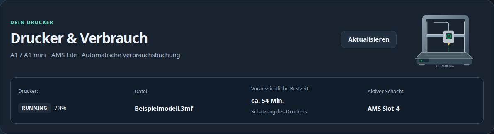
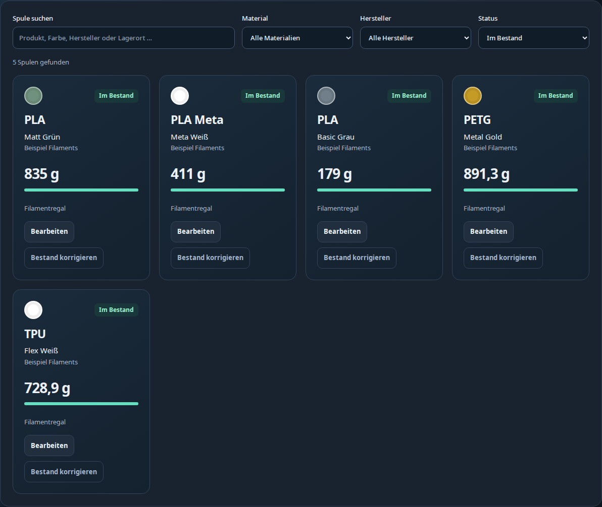
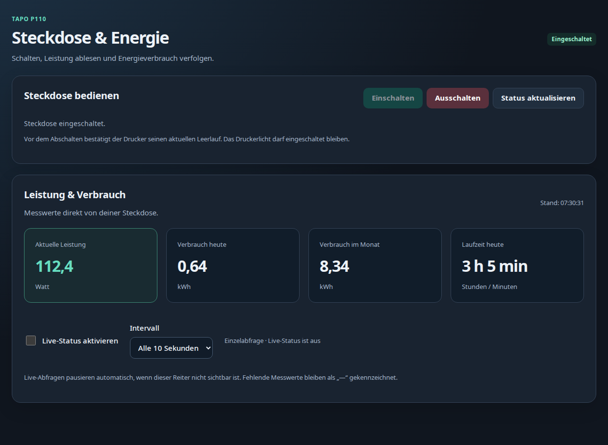
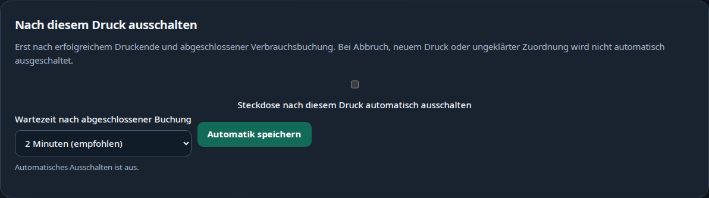

# Bedienungsanleitung

Bambu-Spoolman-Plus verbindet lokale Druckerüberwachung, AMS-Zuordnung, Filamentbestand, Verbrauchsjournal, Kamera und eine Tapo-P110-Steckdose. Diese Anleitung beschreibt den Stand vom 16. November 2026. Die Abbildungen zeigen die tatsächlich gerenderte aktuelle Oberfläche mit ausschließlich künstlichen Beispieldaten. Sie sind keine Hardwaremessungen und enthalten keine privaten Bestände.

## Inhalt

- [Voraussetzungen und Druckermodus](#voraussetzungen-und-druckermodus)
- [Drucker und Verbrauch](#drucker-und-verbrauch)
- [Spulen im AMS Lite](#spulen-im-ams-lite)
- [Filamente und physische Spulen](#filamente-und-physische-spulen)
- [Wiegen und Bestandskorrektur](#wiegen-und-bestandskorrektur)
- [Löschen und Archivieren](#löschen-und-archivieren)
- [Journal und offene Druckaufträge](#journal-und-offene-druckaufträge)
- [Kamera und Licht](#kamera-und-licht)
- [Steckdose und Energie](#steckdose-und-energie)
- [Automatisch nach dem Druck ausschalten](#automatisch-nach-dem-druck-ausschalten)
- [Einstellungen und Flusskontrolle](#einstellungen-und-flusskontrolle)
- [Fehlersuche und Grenzen](#fehlersuche-und-grenzen)

## Voraussetzungen und Druckermodus

### Für Material- und Farbübertragung an das AMS

Am kompatiblen Bambu A1/A1 mini müssen **LAN-only-Modus und Entwicklermodus (Developer Mode)** eingeschaltet sein, damit die App auf der getesteten Firmware Material und Farbe direkt an das AMS schreiben kann. Die Bezeichnung und Position der Schalter können je nach Firmware abweichen. Den Moduswechsel nach Druckende am Drucker vornehmen; die App ändert den Betriebsmodus nicht selbst.

1. Am Drucker die Netzwerkeinstellungen öffnen und LAN-only aktivieren.
2. Den Entwicklermodus aktivieren, soweit als separater Schalter vorhanden.
3. Für die Kamera gegebenenfalls LAN-Livebild aktivieren.
4. Den aktuell gültigen LAN-Zugangscode ausschließlich in der privaten Serverkonfiguration hinterlegen. Nach einem Moduswechsel kann sich der Code ändern.
5. Die App-Verbindung prüfen und zunächst einen inaktiven Schacht im Leerlauf testen.

LAN-only verändert die bisherige Bambu-Cloud-/Handy-Nutzung. Für den lokalen Studio-Zugriff müssen Rechner und Drucker miteinander erreichbar sein. Entwicklerzugriff gehört in ein vertrauenswürdiges lokales Netz; Geräteports nicht ins Internet freigeben. Bambu beschreibt die offenen lokalen MQTT-, Kamera- und FTP-Schnittstellen in seiner [Erklärung zum Entwicklermodus](https://blog.bambulab.com/updates-and-third-party-integration-with-bambu-connect/).

Für die Bridge werden Docker Compose v2, ein persistentes Datenverzeichnis und erreichbare Druckerports benötigt: MQTT/TLS 8883, implizites FTPS 990 einschließlich passiver Datenports und der unterstützte LAN-Kamerastream. Individuelle Adressen, Codes und Passwörter gehören ausschließlich in die private Konfiguration.

### Bestandssystem

Es gibt zwei Betriebsarten: den bestehenden Spoolman-REST-Bestand und das integrierte SQLite-Inventar. Die vollständige Produkt-, Spulen- und Korrekturverwaltung dieser Anleitung setzt das **kontrolliert aktivierte interne Inventar** voraus. Die App fällt nicht automatisch auf ein anderes Bestandssystem zurück. Ein Wechsel erfordert vollständige Sicherungen, einen Testimport und die Offline-Umschaltung nach [Betrieb und Wiederherstellung](plus-operations.md); eine Umgebungsvariable allein genügt nicht.

## Drucker und Verbrauch

Die Übersicht zeigt Inventarverbindung, Druckerzustand, Fortschritt, Datei, aktiven Schacht und voraussichtliche Restzeit. Die Restzeit stammt vom Drucker und wird nicht aus dem Prozentfortschritt hochgerechnet. Fehlende oder länger als drei Minuten veraltete Zeitangaben werden nicht als aktuelle Prognose angezeigt. Nach Abschluss steht „Abgeschlossen“; offline wird keine alte Restzeit weiterverwendet.

Während des Drucks sammelt die App Metadaten und beobachtete Schächte. Sie bucht den Verbrauch erst nach dem Ende. Die Grammwerte stammen aus der ausgewählten Druckplatte der geslicten 3MF-Datei; sie sind keine Wägung des tatsächlich extrudierten Materials.

Die A1-Abbildung ist eine eigene schematische Darstellung. Eine gesunde Anwendung kann einen ausgeschalteten oder nicht erreichbaren Drucker als offline anzeigen: Anwendungs-Health und Druckerverbindung sind verschiedene Zustände.

## Spulen im AMS Lite

### Normaler Rollenwechsel über die App

1. Physische Rolle im gewünschten Schacht wechseln.
2. Den Schacht in der Grafik oder über Slot 1–4 auswählen. Die Grafik ordnet 1/4 oben und 2/3 unten an; die externe Spule steht daneben.
3. Im Auswahlfeld die **konkrete Bestandsrolle** auswählen. Gleiche Produkte können mehrere unabhängige Rollen besitzen.
4. „Rolle übernehmen …“ öffnen. Die Auswahl allein sendet noch keinen Befehl.
5. Unter „Änderung prüfen“ bisherige und geplante Farbe, Materialfamilie, Rolle und gegebenenfalls bekanntes Druckerprofil prüfen.
6. Bestätigen. Stimmen Materialfamilie und Farbe bereits, wird nur die Bestandszuordnung gespeichert. Andernfalls setzt die App die Druckerangaben und ordnet erst nach bestätigter, stabiler Rückmeldung die Rolle zu.

Die App ist damit der primäre Weg für den Rollenwechsel. Die Grafik zeigt bestätigte Druckerwerte, keine ungespeicherten Entwürfe. Der Auswahlrahmen bezeichnet den geöffneten Schacht; der farbige Filamentweg bezeichnet den gemeldeten aktiven Schacht. Auswahl und tatsächliche Nutzung sind unabhängig.

Schreibbefehle verwenden ein aktuelles, vom Drucker bereits bekanntes Profil derselben Materialfamilie einschließlich gültiger Temperaturangaben. Profilkennungen und Temperaturen werden nicht geraten. Ohne geeignetes Profil den Materialtyp zunächst über Bambu Studio bereitstellen. Eine Metadatenänderung lädt oder entlädt kein Filament und verändert keine Slicer-Druckprofile.

### Bestätigung, Zeitbedarf und Sicherheit

Eine Vorschau gilt zwei Minuten. Geänderte Rollen-, Schacht- oder Zuordnungsdaten verlangen eine neue Prüfung. Die App prüft die Antwort auf den konkreten MQTT-Befehl **und** passende neue Zustandsdaten. Vorübergehend leere oder erneut befüllte Schachtmeldungen müssen sich stabilisieren. Die Bestätigung kann deshalb einige zehn Sekunden dauern.

Ein bloß erfolgreich gesendeter Befehl oder eine unveränderte passende Altfarbe genügt nicht als Erfolg. Bei unklarem Ergebnis nicht wiederholt klicken: tatsächlichen Druckerstand prüfen und eine neue Vorschau öffnen. Die App wiederholt solche Schreibversuche nicht selbstständig. Andere Schächte bleiben bei einer Einzeländerung unverändert.

### Änderungen während eines Drucks

Bei frischem, eindeutigem Druckerstatus dürfen **andere, inaktive Schächte** geändert werden. Gesperrt sind der aktive Schacht und der bereits zum Filamentwechsel angeforderte Schacht. Bei unbekannter Slotlage, Offline-Zustand oder nicht ausreichender Aktualität bleibt die Schreibaktion gesperrt. Auch pausierte Drucke schützen die benötigten Schächte.

Ändert sich eine für den laufenden Auftrag relevante Bestandsrolle, wartet dessen automatische Buchung auf eine ausdrückliche Zuordnungsprüfung. Gespeicherte Rollensnapshots werden nicht stillschweigend ersetzt. Eine nachträglich bestätigte Rollenaufteilung bleibt eine Schätzung; die App misst keine rollenbezogenen Teilmengen beim Wechsel.

Die Schachtfreigabe während eines Drucks ist durch automatisierte und Browserprüfungen abgedeckt. Der echte Farbwechsel nach Aktivierung des Entwicklermodus wurde bisher im Leerlauf geprüft; ein solcher Farbwechsel während eines laufenden Drucks ist noch nicht physisch bestätigt.

### Fallback für Änderungen in Bambu Studio oder am Drucker

Unter „Abgleich mit Bambu Studio / Drucker“ lässt sich die Auswahl auf bereits passende Material-/Farbkombinationen einschränken. Standardmäßig stehen alle aktiven Bestandsrollen zur Verfügung. „Nur Bestand zuordnen …“ verbindet eine Rolle mit dem vorhandenen Druckerstand. Eine bewusste Abweichung muss zusätzlich bestätigt werden. „Zuordnung lösen …“ betrifft nur den ausgewählten Schacht. Die externe Spule wird hier ausschließlich im Bestand zugeordnet.

Ein gemeldeter Wechsel von Material, Farbe oder Belegung kann eine alte Zuordnung für künftige Aufträge lösen. Identische Rollen mit identischen Druckerangaben lassen sich ohne gemeldete Leerphase nicht unterscheiden; diesen Wechsel ausdrücklich selbst zuordnen.

### Materialfamilien

PLA-Varianten wie PLA+, PLA Meta und PLA-CF lassen sich mit der AMS-Kategorie PLA abgleichen; PETG-Varianten wie PETG-CF oder PETG-HF entsprechend mit PETG. Die exakte RGB-Farbe bleibt erforderlich. Eine Familie bedeutet keine Austauschbarkeit von Temperaturen, K-Faktor, Fluss oder Druckprofil. Der Filamenttyp im Bestand darf seine genauere Bezeichnung behalten. Die automatisch abgeleitete AMS-Kategorie wird in der Produktverwaltung angezeigt.

## Filamente und physische Spulen

Ein **Filamentprodukt** beschreibt Hersteller, Bezeichnung, Typ und Farbe. Eine **physische Spule** ist eine bestimmte Rolle dieses Produkts mit eigenem Lagerort, Restbestand, Leergewicht und gegebenenfalls Charge. Zwei gleiche Rollen teilen das Produkt, aber nicht ihre Bestände oder Schachtzuordnungen.

1. Unter „Filamente“ zunächst nach vorhandenem Produkt suchen; Material-, Hersteller- und Statusfilter nutzen.
2. Ein fehlendes Produkt im Reiter „Filamentprodukte“ anlegen. Die Bezeichnung enthält den gewünschten Farbnamen. Der Filamenttyp darf beispielsweise PLA+ oder PETG-CF heißen.
3. Reines Filamentgewicht einer vollen Rolle und **Leerspulengewicht** getrennt pflegen. „Sonstiges“ enthält freie Zusatzangaben. Durchmesser und Dichte stehen unter weiteren Angaben.
4. Fehlt der Hersteller, im selben Dialog „Neuen Hersteller anlegen“ wählen und den Namen eingeben. Hersteller und Produkt werden zusammen gespeichert; bereits ausgefüllte Felder bleiben erhalten.
5. Danach „Spule hinzufügen“: Produkt, Lagerort und tatsächlichen Eröffnungsbestand auswählen. Leer lassen bedeutet „unbekannt“, nicht null.
6. Die konkrete Rolle dem AMS-Schacht zuordnen.

Artikelnummer, separater Farbname und Variante sind keine nötigen Eingabefelder mehr. Frühere Werte bleiben gespeichert. „Sonstiges“ ist aufklappbar, damit Bearbeiten und Löschen gut erreichbar bleiben. Tabellenüberschriften sortieren auf- und absteigend; Gewichte werden numerisch sortiert. Die AMS-Rollenauswahl zeigt Gewichte mit einer Nachkommastelle. Neu berechnete Restbestände bei Buchungen und Korrekturen werden auf zwei Nachkommastellen gerundet; historische Buchungen werden nicht nachträglich umgeschrieben.

### Optionaler Filamentkatalog

Bei neuen Produkten kann „Mit Vorlage aus dem Katalog starten“ die Stammdaten aus **SpoolmanDB** übernehmen. Nach Hersteller, Material oder Produkt suchen, Treffer wählen, Werte prüfen und speichern. Die Vorlage kann einen fehlenden Hersteller mit anlegen. Bestehende Produkte für zusätzliche Rollen wiederverwenden.

Die App verwendet derzeit keinen automatischen Import von 3dfilamentprofiles.com. SpoolmanDB wird als öffentliche JSON-Datei geladen und serverseitig durchsucht; der Suchbegriff wird nicht als Anfrage an einen externen Suchdienst gesendet. Der Cache bleibt sechs Stunden im Speicher. Bei Ausfällen kann ein älterer Cache weiterhelfen, andernfalls bleibt die manuelle Anlage verfügbar.

Übernommen werden Stammdaten einschließlich Herkunft und Originaldatensatz. Es gibt keine automatische Aktualisierung vorhandener Produkte und keine Übertragung von Slicer-Profilen. Ein Katalogeintrag ersetzt keine Temperatur-, Fluss- oder K-Faktor-Kalibrierung.

## Wiegen und Bestandskorrektur

1. Bei der konkreten Rolle „Bestand korrigieren“ öffnen.
2. „Wiegekorrektur · Spule gewogen“ auswählen.
3. Das **Gesamtgewicht von Spule und Filament** eingeben.
4. Das vorgeschlagene Leerspulengewicht prüfen: zuerst das individuelle Spulengewicht, sonst der Produktstandard. Fehlendes Leergewicht ergänzen.
5. Vorschau prüfen, Grund beziehungsweise Ergänzung eintragen und speichern.

Beispiel: 1.111,3 g Gesamtgewicht − 220 g Leerspule = 891,3 g Filament. Die App rechnet selbst. Auch zuvor unbekannter Bestand kann so erstmals gesetzt werden. Eine Änderung des Produkt-Nenngewichts allein korrigiert keinen vorhandenen Restbestand.

Alternativ „Filament hinzufügen“ oder „Filament abziehen“ mit positiver Teilmenge verwenden. Korrekturen erscheinen mit Datum, Vorher-/Nachherbestand und Grund im gemeinsamen Journal; Wiegekorrekturen zusätzlich mit Gesamt- und Leergewicht. Sie werden nicht als Druckverbrauch gezählt. Simulation ist kein Schutzschalter für diese absichtlichen Inventarkorrekturen.

## Löschen und Archivieren

| Aktion | Zweck und Auswirkung |
|---|---|
| Archivieren | Rolle aus dem aktiven Bestand nehmen; Datensatz und Historie bleiben erhalten. |
| Löschen | Unbenutzte Einträge endgültig löschen, sofern keine Referenzen bestehen. Produkte mit vorhandenen Rollen bleiben geschützt. |
| Aus Inventar entfernen | Archivierte Rolle aus Listen, Zählern und Auswahlfeldern ausblenden; historischer Datensatz und Buchungen bleiben erhalten. |

Für eine archivierte Rolle mit Historie ist **„Aus Inventar entfernen“** der richtige Weg. Zuerst aktuelle AMS-Zuordnungen lösen und offene Druckaufträge beziehungsweise Zuordnungsprüfungen klären. Alte abgeschlossene Drucke verhindern das Entfernen nicht. Die andere Rolle desselben Produkts bleibt unabhängig erhalten.

Entfernte Rollen können nicht erneut ausgewählt, bearbeitet oder reaktiviert werden. Vollständige Inventarexporte enthalten ihre historischen Datensätze weiterhin. Die Bestätigungsfrage vor dem Entfernen erläutert die Folgen.

## Journal und offene Druckaufträge

Das Journal zeigt Datum und Uhrzeit, Auftrag, Schacht, Rolle, Menge, Status und Details. Erfolgreiche interne Buchungen aktualisieren Bestand und Verbrauch gemeinsam in einer SQLite-Transaktion. Wiederholtes FINISH oder eine Wiederaufnahme erzeugen keine zweite Buchung derselben Position.

Bei Abbruch lautet der Hinweis „Teilmenge bis Abbruch gebucht“. Die Grundlage bleibt Slicer-Menge × letzter bekannter Fortschritt. Das ist insbesondere bei Mehrmaterial keine genaue Extrusionsmessung. Bei null geschätztem Verbrauch entsteht keine positive Buchung. Rechnerische Aufteilungen auf Rest- oder Reservespulen werden ebenfalls gekennzeichnet.

| Zustand | Bedeutung / nächster Schritt |
|---|---|
| RUNNING | Daten werden gesammelt; noch keine Verbrauchsabbuchung. |
| WAITING_METADATA | Eindeutige Verbrauchs-/Platteninformationen fehlen; Datei und Erreichbarkeit prüfen. |
| WAITING_MAPPING | Zuordnung fehlt, ist mehrdeutig oder wurde druckrelevant geändert; Auftrag prüfen und bestätigen. |
| DONE | Bestandsbuchung bestätigt. |
| DRY_RUN | Nur simuliert; wird später nicht nachgebucht. |
| RETRY | Sicher noch nicht bestätigte Buchung wird mit unverändertem Plan erneut geprüft. |
| UNKNOWN | Ergebnis einer externen Buchung unklar; Bestand manuell prüfen, keine automatische Wiederholung. |
| REJECTED | Buchung abgelehnt; Details prüfen und Ursache klären. |

Wenn beim Druckstart eine Bestandsrolle fehlte, zuerst die richtige Rolle dem betreffenden AMS-Schacht zuordnen und anschließend die Auftragszuordnung bestätigen. Diese Bestätigung ergänzt auch die ursprünglich leere Rollenbindung im Auftrag; bereits gespeicherte Rollen bleiben erhalten. Vorhandene Verbrauchsmetadaten genügen, selbst wenn die ursprüngliche Druckdatei nicht mehr erreichbar ist. Ohne gespeicherte Verbrauchsdaten kann eine Zuordnung allein keine Grammmenge erzeugen.

Unter „Druckaufträge und Filamentzuordnung“ gilt die Bestätigung für genau diesen Auftrag. Bereits verarbeitete Positionen bleiben geschützt. Die tatsächliche Bestandsrolle und die Slicer-Filamentposition sind unterschiedliche Zuordnungsstufen. Einzelheiten: [Filament-Workflow](filament-workflow.md) und [Architektur](architecture.md).

## Kamera und Licht

„Livebild öffnen“ verbindet die Kamera bei Bedarf. „Livebild schließen“, Seitenwechsel oder Ausblenden beendet die Anzeige; bei Bedarf wieder öffnen. Die Lichtschalter stehen oberhalb der Bildfläche und funktionieren auch ohne geöffnetes Livebild.

Eine Lichtaktion ist erst nach einer **neuen passenden Druckerrückmeldung** erfolgreich. Das bestätigt den gemeldeten Gerätezustand, ist aber keine optische Lampenmessung. Das Licht ist unabhängig von der Tapo-Steckdose.

Unterstützt wird der implementierte A1/P1-LAN-Kamerastream; X1/RTSP ist nicht integriert. Nur eine Anzeige kann gleichzeitig laufen. Bei „Kamera wird bereits angezeigt“ die andere Ansicht schließen. Kameraausfälle stoppen keine Verbrauchsbuchung.

## Steckdose und Energie

Die Tapo P110 benötigt eine private Konfiguration und Erreichbarkeit aus dem Container. Die Seite zeigt Leistung in Watt, Tages-/Monatsenergie in kWh und heutige Laufzeit. Diese Messwerte werden nicht einzelnen Druckaufträgen zugerechnet. Fehlende Werte stehen als „—“; nach Fehlern werden alte Daten nicht als neu ausgegeben.

„Status aktualisieren“ fragt einmalig ab. „Live-Status aktivieren“ erlaubt Abfragen alle 5, 10 oder 30 Sekunden; bei unsichtbarem Reiter pausieren sie. Einschalten ist manuell möglich.

Beim Ausschalten wird expliziter Druckerleerlauf geprüft. Ein höchstens 30 Sekunden alter bestätigter Zustand IDLE/FINISH kann verwendet werden; ältere Zustände werden neu angefordert. Direkt vor dem Schalten prüft der getrennte Tapo-Hilfsprozess erneut Verbindung, Aktualität und Leerlauf. Laufender oder pausierter Druck, unbekannter Zustand, Offline und fehlende Antwort sperren das Ausschalten. **Eingeschaltetes Druckerlicht blockiert nicht.** Ein ausgeschalteter Drucker kann selbst keinen frischen Leerlauf bestätigen.

Die Konfiguration nutzt `TAPO_HOST`, `TAPO_USERNAME`, `TAPO_PASSWORD` oder die entsprechenden `_FILE`-Variablen mit geschützten, im Container lesbaren Dateien. Keine Gerätezugänge in Screenshots oder Exporte für GitHub aufnehmen. Der Hilfsprozess isoliert Fehler der nativen Gerätebibliothek von der Webanwendung.

## Automatisch nach dem Druck ausschalten

In der Druckübersicht „Nach diesem Druck ausschalten“ für den **aktuellen laufenden Auftrag** aktivieren, Verzögerung wählen und speichern. Standard: zwei Minuten; wahlweise eine oder drei. Die Option ist standardmäßig aus und gilt nicht dauerhaft für folgende Drucke.

1. Normalen Druckabschluss abwarten.
2. Verbrauchsbuchung und gegebenenfalls Zuordnungsprüfung vollständig abschließen.
3. Gewählte Verzögerung abwarten.
4. Neue explizite Leerlaufmeldung anfordern.
5. Auftrag, aktivierte Option und Druckerzustand unmittelbar vor dem Tapo-Schalten erneut prüfen.

Abbruch, neuer Druck, ungeklärte Buchung oder fehlender Leerlauf verhindern das Schalten. Ein unklarer Ausschaltversuch wird nicht automatisch wiederholt. Nach Neustart während eines Schaltversuchs bleibt die Automatik aus. Sie schaltet den Drucker nicht selbst ein.

Die Verzögerung ist **keine temperaturgeführte Abkühlprüfung**. Die Funktion prüft keine Düsen- oder Betttemperatur. Native Inventarexporte aktivieren beim Wiederherstellen keine Abschaltautomatik; vollständige SQLite-Sicherungen enthalten dagegen den gespeicherten Zustand. Ein echter automatischer Abschaltzyklus dieser neuen Funktion ist bisher noch nicht hardwarebestätigt.

## Einstellungen und Flusskontrolle

### Simulation

„Verbräuche nur simulieren“ schreibt keine Druckverbräuche in den Bestand. Frühere Simulationen werden nach Deaktivierung nicht nachgebucht. Der Modus wird je Auftrag gespeichert. Er verhindert keine ausdrücklich ausgelösten Geräteaktionen oder Inventarkorrekturen.

### Automatischer Abgleich

„Passende Spulen automatisch finden“ ergänzt fehlende Slicer→AMS-Zuordnungen anhand der gespeicherten Materialfamilie und exakten Farbe. Es gibt keine Farbnähe-Toleranz und keine automatische Erkennung der physischen Rollenidentität. Die externe Spule muss ausdrücklich zugeordnet werden. Die App-Zuordnung bleibt der bevorzugte Rollenwechselablauf.

### Flusskontrolle: 2 g je Farbe

„Flusskontrolle berücksichtigen · 2 g je Farbe“ ist ein **manueller Verbrauchszuschlag** und startet keine Kalibrierung. Standardmäßig aus. Die Einstellung wird beim Erkennen eines neuen Druckauftrags festgeschrieben; spätere Änderungen gelten erst für weitere Aufträge.

Technisch bedeutet „je Farbe“: **je Slicer-Filamentposition mit positivem geplantem Verbrauch** einmalig 2 g zusätzlich. Zwei gleichfarbige, separat angelegte Slicer-Positionen können daher jeweils einen Zuschlag erhalten. Die App behauptet keine gemessene Kalibrierungsmenge. Bei einer Aufteilung auf mehrere Rollen wird der Zuschlag mit der Gesamtmenge verteilt und nicht pro Reservespule erneut addiert.

Beispiel: 10 g Rot + 20 g Gold laut Slicer → bei aktivierter Option 12 g Rot + 22 g Gold. Der Journalhinweis nennt den pauschalen Zusatzverbrauch als Schätzung. Der Buchungsplan wird eingefroren, sodass Wiederaufnahme und Wiederholung keinen weiteren Zuschlag erzeugen.

Bei Abbruch wird der Grundverbrauch weiterhin nach Fortschritt geschätzt. Jede dabei positive Filamentposition erhält den vollen 2-g-Zuschlag; es wird keine genaue Verwendung einzelner Farben bis zum Abbruch gemessen. Bei null geschätztem Verbrauch entfällt auch der Zuschlag. Deshalb vor allem bei frühen Abbrüchen und Mehrmaterial das Ergebnis prüfen.

Die Option ausschalten, wenn keine Flusskalibrierung läuft oder deren Verbrauch bereits in den verwendeten Grammwerten enthalten ist. Eigenständige Kalibrierungsdrucke können selbst als Auftrag erfasst werden; einen zusätzlichen Zuschlag dafür bewusst prüfen.

### Automatische Erkennung der Kalibrierung

Die dokumentierte Startanfrage kennt `flow_cali`. Das ist keine hier nachgewiesene, dauerhaft verfügbare Statusbestätigung für einen aus Bambu Studio gestarteten A1-Auftrag. Die App erkennt diesen Schalter derzeit **nicht automatisch**. Bei einem künftig von der App selbst ausgelösten Start könnte die ausdrücklich gewählte Option gespeichert werden. Quelle: [OpenBambuAPI – project_file](https://github.com/Doridian/OpenBambuAPI/blob/main/mqtt.md#printproject_file).

## Fehlersuche und Grenzen

| Beobachtung | Prüfung |
|---|---|
| AMS-Schreibbefehl abgelehnt, etwa 84033543 | Nach Druckende LAN-only und Entwicklermodus, aktuellen Code und Verbindung prüfen. Modus nicht während eines Drucks wechseln. |
| Kein geeignetes AMS-Profil | Materialtyp zuerst über Bambu Studio setzen; keine Kennungen oder Temperaturen erraten. |
| Rolle gewählt, Drucker unverändert | Auswahl ist nur Entwurf; Vorschau öffnen und bestätigen. Fehlermeldung beziehungsweise unklare Rückmeldung prüfen. |
| Schacht während Druck gesperrt | Aktiver oder angeforderter Schacht, unbekannte Slotlage oder veralteter Status. |
| Archivierte Rolle nicht endgültig löschbar | Aktuelle Zuordnung lösen, offene Aufträge klären und „Aus Inventar entfernen“ verwenden. |
| Ausschalten gesperrt | Eindeutiges IDLE/FINISH und aktuelle Verbindung erforderlich; Lichtzustand ist kein Hindernis. |
| Sitzung abgelaufen | Seite neu öffnen und Eingabe wiederholen; abgelehntes Formular wurde nicht gespeichert. |
| Produktvorlage nicht verfügbar | Katalogverbindung prüfen oder Produkt manuell anlegen. |

Die Anwendung ist auf einen Drucker und dessen AMS Lite zugeschnitten. Eine beliebige Mehrdruckersteuerung, automatisches physisches Rollenladen, slicerbezogene Profilkalibrierung, temperaturgeführtes Ausschalten und eine automatische Erkennung der aktivierten Flusskontrolle sind hier nicht implementiert. Zusätzliche lokale Firmwarebefehle durch Developer Mode sind keine automatisch bereits integrierten App-Funktionen.

Private `.env`, Zugänge, Schlüssel, Datenbanken, Logs, Inventarexporte und Backups außerhalb von Git aufbewahren. Vollständige Exporte können eigene Notizen und historische Datensätze enthalten. Installation und Wiederherstellung: [Betrieb](plus-operations.md). Entwicklungs- und Hardwareprüfung: [Deployment und Prüfung](../DEPLOYMENT.md).
